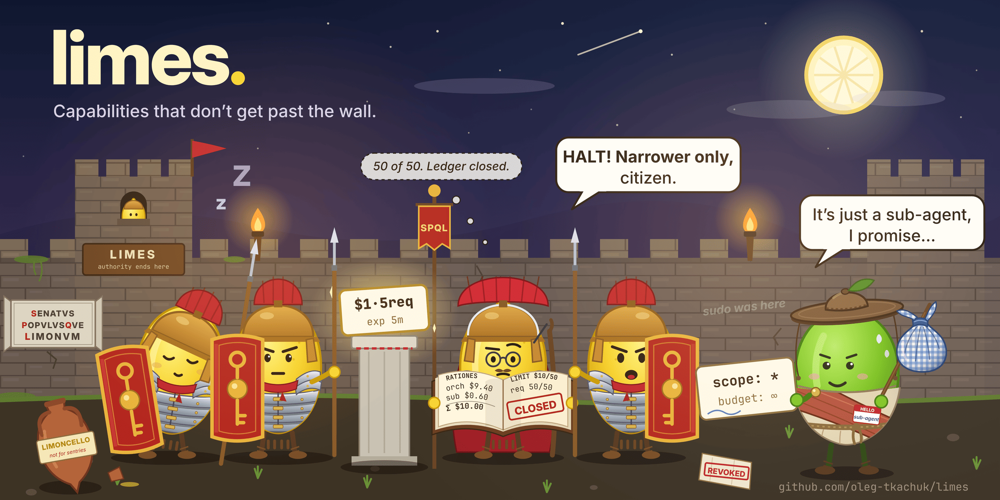
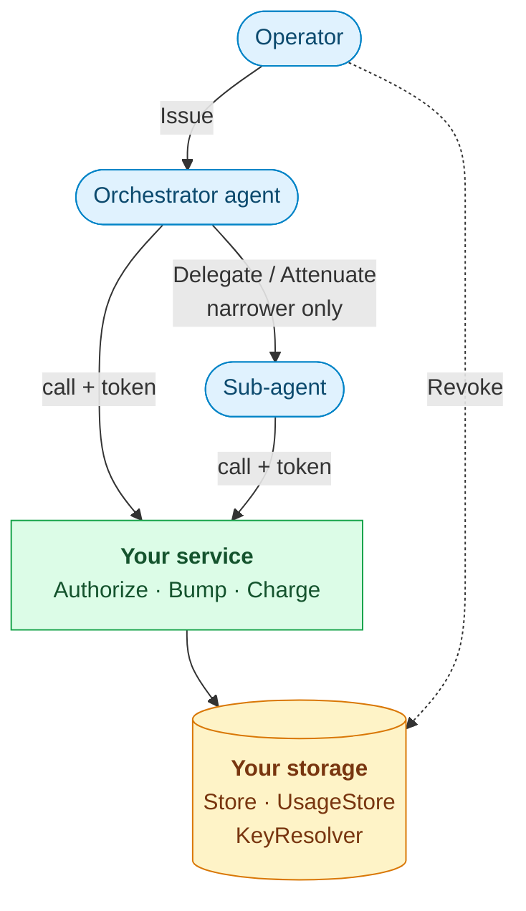

# limes

[](https://github.com/oleg-tkachuk/limes/actions/workflows/ci.yaml)
[](https://github.com/oleg-tkachuk/limes/releases/latest)
[](go.mod)
[](LICENSE)

Budgeted, delegable, individually revocable capabilities for agentic workloads,
as a Go library.

A capability is a short-lived signed token that carries its own authority:
which operations, on which resources, for how much money and how many
requests, until when, and on whose behalf. An agent can hand a sub-agent a
strictly narrower copy, through the issuer or offline as a Biscuit block.
Every charge counts against the whole delegation chain, and revoking a
capability mid-flight revokes everything delegated from it.

The module ships the primitive and its contracts; you supply the storage. Its
resolved dependency graph holds no database driver and no storage SDK.
`memstore`, an in-memory implementation, is enough to start.

*Limes* was the fortified frontier of the Roman Empire — a line that marks how
far authority reaches ([Wiktionary](https://en.wiktionary.org/wiki/Limes),
[Wikipedia](https://en.wikipedia.org/wiki/Limes_(Roman_Empire))).



## Install

```bash
go get github.com/oleg-tkachuk/limes@latest
```

limes needs Go 1.27 or later: its identifiers are the standard library's
`uuid.UUID`.

`pgstore`, `redisreplay`, `otelmetric`, `exchange` and `biscuit` are modules
of their own; pin each by its own tag ([Versioning](#versioning)). The
Biscuit form lives in `biscuit`: to read or seal it, set `biscuit.Form()` as
`VerifierConfig.Biscuit.Form` or `IssuerConfig.Biscuit`.

## Five minutes

Setup errors are dropped below for brevity; each constructor returns one.

```go
ctx := context.Background()
tenantID, runID := uuid.New(), uuid.New() // the standard library's uuid
key, _ := limes.GenerateKey()
kid, pub, priv := key.KeyID, key.Public(), key.Private

records, _ := memstore.NewStore(memstore.StoreConfig{}) // your Store
usage, _ := memstore.NewUsageStore(memstore.UsageStoreConfig{Records: records})

signer, _ := limes.NewSigner(limes.SignerConfig{KeyID: kid, Key: priv})
issuer, _ := limes.NewIssuer(limes.IssuerConfig{
    Signer: signer, Store: records, IssuerName: "my-issuer",
})
keys, _ := jwks.NewStatic(jwks.StaticConfig{Keys: map[string]ed25519.PublicKey{kid: pub}})
verifier, _ := limes.NewVerifier(limes.VerifierConfig{
    Keys:           keys,
    Revocations:    records,
    TrustedIssuers: []string{"my-issuer"},
})

issued, _ := issuer.Issue(ctx, limes.IssueRequest{
    IssuedBy: limes.Principal{Subject: "operator@example.com"}, // who asked
    ClientID: "my-agent", // the OAuth client: the software the agent runs as
    Subject: limes.Principal{
        Type: limes.PrincipalTypeAgent, TenantID: tenantID,
        Subject: "research-orchestrator",
        Agent:   &limes.AgentPrincipal{AgentType: "my-agent", RunID: runID},
    },
    Audience: []string{"my-service"},
    TTL:      15 * time.Minute,
    Caveats: limes.Caveats{
        Ops:              []limes.Op{limes.OpGet, limes.OpShare},
        ResourcePrefixes: []string{"corpus/public/"},
        Requests:         limes.RequestCeiling{Max: 500},
        Budget:           limes.BudgetCeiling{Max: limes.MustParseAmount("25.00"), UnitCode: "USD"},
    },
})

// On every call: verify locally and enforce the caveats in one step, then meter.
granted, err := verifier.Authorize(ctx, limes.AuthorizeRequest{
    Verify: limes.VerifyRequest{Token: issued.Token, Audience: "my-service"},
    Check:  limes.CheckRequest{Op: limes.OpGet, Resource: "corpus/public/report.pdf"},
})
if err != nil {
    return err // a refusal, e.g. limes.ErrResourceNotAllowed outside corpus/public/
}
subject := granted.MeterSubject()
if _, err := usage.Bump(ctx, meter.BumpRequest{Subject: subject}); err != nil {
    return err // limes.ErrRequestLimitExceeded past the 500th request
}
if _, err := usage.Charge(ctx, meter.ChargeRequest{
    Subject: subject, Amount: limes.MustParseAmount("0.35"),
}, nil); err != nil {
    return err // limes.ErrBudgetExceeded past 25.00, with nothing counted
}
```

`IssueRequest` requires `Subject` with its `TenantID` and `Subject`,
`IssuedBy.Subject`, `ClientID`, `Audience` and `Caveats`. `TTL` defaults to
`IssuerConfig.DefaultTTL`, fifteen minutes unless set. `issued.Token` is what
the agent carries; `issued.Capability` is the record you keep for audit.
`verifier.ErrorResponse(ctx, err, limes.AuthSchemeBearer)` turns a refusal
into the HTTP status, `WWW-Authenticate` challenge and problem body to answer
with.

`go run ./quickstart` in [examples/](examples) runs issue, authorize,
delegate, meter and revoke end to end. The other examples there take one
step each, pgstore included.

## What it does

| Feature | What it does |
|---|---|
| **Verify** | Local Ed25519 JWT verification (`alg: Ed25519`, RFC 9864, or `EdDSA` for older JOSE libraries) against a resolved key: static, or an issuer's JWKS fetched by `jwks.Remote`, which revalidates by ETag and honours `Cache-Control`. Claims are read strictly: no unknown or duplicate member, integers within I-JSON's range. Rejections match sentinel errors (`errors.Is`) in families — `ErrUnauthenticated` over `ErrInvalidToken` and `ErrProofOfPossession` — and failures that must not tell an attacker which check failed share `ErrInvalidToken`. |
| **Enforce** | `Authorize` verifies and checks every stateless caveat in one call: allowed ops, resource prefixes matched at `/` boundaries (a `.` or `..` segment never matches), exact URIs (`ResourceURIs`), string name prefixes (`ResourceNamePrefixes`), idempotency keys for writes, tainted reads, source networks. Request and budget limits are the `Meter`'s. |
| **Delegate** | `Issuer.Delegate` issues a child that may only be narrower in operations, resources, limits and audience; anything wider is `ErrDelegationTooWide`. The child's validity fits inside the parent's: a TTL past the parent's expiry is cut to it, and a `NotBefore` before the parent's start is raised to it. The child counts in the parent's unit; another unit is `ErrUnitCodeMismatch`, a conflict (`ErrConflict`, 409). The parent must allow `OpShare`, or the delegation is `ErrOpNotAllowed`. An expired or revoked parent delegates nothing. |
| **Attenuate offline** | The holder of a capability's Biscuit v3 form can narrow it with no key and no network. Each copy can get its own limits, up to the copy quota signed in the token (`Caveats.Copies`) across the delegation chain, and be revoked on its own. |
| **Bind to a key** | RFC 9449 DPoP: `Verify` refuses a key-bound capability without a fresh proof from that key, and, given the scheme it came under, one not presented under `DPoP`. Server nonces (`dpop.HMACNonces`) work across replicas without shared state. |
| **Meter** | Requests count against the capability, every ancestor and each Biscuit copy with limits presented; spend counts against those and the tenant, atomically with your own side effect. Each copy with limits of its own counts against the copy quota of the capability and of every ancestor. Reserve an estimate, settle the actual cost, refund a charge. Amounts are exact integers of billionths of an ISO 4217 unit. `otelmetric.Instrument`, a module of its own, adds OpenTelemetry instruments. |
| **Revoke** | One call to a `Revoker` stops a capability and everything delegated from it; it logs each revocation and reports it to `RevokerEvents`. Verifiers learn of it within a cache TTL, or at once on `ClearRevoked`, which drops only the answers the revocation outdates. `pgstore.RevocationWatcher` calls it through a `RevocationSignal` for each revocation it can name, and clears the whole cache otherwise; `otelmetric.InstrumentRevocationCache` exports the cache's counts. `Revoker.RevokeMatching` revokes in batches by subject, on-behalf-of user, client, identity-provider session, subject issuer or agent run; `meter.MatchingReleaser` frees their holds at once, and the census and the listing preview both. |
| **Report** | `LedgerReader.SumCharges` sums the charges of one tenant or of every tenant over a period by unit, whole or by UTC hour, day, ISO week or month, grouped and filtered by any of tenant, operation, actor and capability, largest first. `RecordCensus.CountRecords` counts capability records — active, expired, revoked, delegated, expiring soon — for one tenant or all, by tenant and principal type. `RecordLister.ListRecords` lists one tenant's records, or every tenant's in one order, each with its disposition by the census's rules, filtered by principal type, subject or subject prefix, on-behalf-of user, client, session, subject issuer, agent run and disposition, oldest or newest first. `RecordListingReader.GetRecordListing` reads one record with its disposition. |
| **Exchange** | `exchange` turns an identity provider's access token into a capability (RFC 8693), one per subject token, in process or at a token endpoint. `HasLimesKeyID` tells a capability from the provider's token on a route that takes both. |
| **Answer errors** | `ErrorResponse` maps a refusal to its status, an RFC 6750 / RFC 9449 `WWW-Authenticate` challenge and an RFC 9457 problem body, without the error's own text. Every error has a stable code (`CodeOf`). `ProblemOf`, which covers the meter's codes, and `exchange.ErrorOf` answer it on any other API. |

You implement `Store`, a `KeyResolver` (`jwks.Static` and `jwks.Remote`
already are one) and, to meter, `meter.UsageStore` — or use `memstore`, or
`pgstore` over PostgreSQL. Test your implementation with the conformance
suites `storetest`, `metertest` and `jwkstest`. Each optional
contract serves one feature; the overviews of
[limes](docs/api/capabilities.md#package-limes) and
[meter](docs/api/metering.md#package-meter) list them, and the
[API reference](docs/api/README.md) has every name.

## Guarantees

- **Charges are atomic.** A failed side effect, or a rejection by any
  ceiling, leaves every counter and the ledger untouched, so a retry is safe.
- **Delegation and attenuation never widen.** A fuzz test
  (`FuzzNarrowsNeverWidens`) checks that whatever `Narrows` accepts reaches no
  resource the parent cannot. An offline Biscuit block that asks for more
  invalidates the token.
- **A bound token needs its key**, and its children stay bound.
- **Keys never reach a log.** A signing key is held as a `SealedKey`
  (`SealKey`) and HMAC nonce keys as `dpop.NonceKeys` (`dpop.SealNonceKeys`).
  Both print redacted under any format verb, in JSON and in slog, and both
  keep a copy, so the caller may clear its own.
- **The token format is pinned.** Golden tokens in `testdata/` and
  `biscuit/testdata/` fail CI on any wire-format drift, because tokens
  outlive deployments.
- **No hidden dependencies.** `isolation_test.go` fails if a database driver,
  an object-storage SDK, a Redis client, OpenTelemetry, biscuit-go or
  protobuf enters the root module's resolved dependency graph.
  `exchange/isolation_test.go` keeps every JOSE library out of package
  `exchange`; only `exchange/jwtverify` links one.
- **The root module's tests need nothing**: no database, no network, no
  container. `pgstore`'s run against PostgreSQL in a container, and
  `redisreplay`'s against miniredis and, in CI, a real Redis.

## Performance

Checking a token is mostly checking its Ed25519 signature. On an Apple M3 Max
core, `Verify` of a JWT takes about 36µs, of which the signature is 33µs;
`Authorize` adds a microsecond or two. A Biscuit takes about 88µs, plus one
signature's worth per attenuation block. A DPoP proof adds some 60µs: its
signature and its own checks. A cached revocation answer takes about 60ns.
The verifier scales with the processors: from four at once, a `Verify` comes
out every 10µs. With `pgstore`, a charge is a transaction of a few
statements, 1.4–3ms against PostgreSQL on the same host. One tenant's
charges commit one at a time — the price of a tenant ceiling that is never
crossed — so some 350–700 a second for one tenant; different tenants'
charges run side by side.

The benchmarks are `bench_test.go`, `biscuit/bench_test.go` and
`pgstore/bench_test.go`, with `otelmetric/bench_test.go` for what the
instruments add. A weekly workflow runs all but the Biscuit's on the current
commit and on the newest release, one after the other on one runner, and
soaks `pgstore` under concurrent workers
([CONTRIBUTING](.github/CONTRIBUTING.md)).

## Versioning

Each module is released as a tag: `vX.Y.Z` for limes, `<module>/vX.Y.Z` for
`redisreplay`, `pgstore`, `otelmetric`, `exchange` and `biscuit`. The version
comes from the Conventional Commits on `main` that touch the module: `feat`
cuts a minor; `fix`, `perf` and `security` a patch; a nested module's own
`build` commit, such as `build(pgstore): bump pgx`, a patch of it. A commit
scoped to a nested module never releases limes, breaking or not.

From 1.0.0 every module's API is stable
([compatibility.md](docs/compatibility.md)): no change on the v1 line breaks a
caller, and CI refuses one that would. A breaking change would be a v2 under
its own module path. Each module's `CHANGELOG.md` holds
them: [CHANGELOG.md](CHANGELOG.md) for limes, `<module>/CHANGELOG.md` for a
nested one.

A release is not cut for every merge
([release-policy.json](.github/release/release-policy.json)). A module is due
once three commits that cut a minor, or five that cut a patch, have gathered
since its last release; a breaking change or a `security` fix is due at
once. The Release workflow can also be run by hand. One release pull request
carries every module due
([ADR-0016](docs/adr/0016-one-release-commit.md)): each one's changelog
entry and, when limes is released, the raised `require` of limes in every
nested module whose files changed since its last release, which is released
with it. The Release workflow tags every module at once on that pull
request's merge commit, so a nested module can require the limes tagged on
the same commit.

Pin each nested module by its own version:
`go get github.com/oleg-tkachuk/limes/pgstore@vX.Y.Z` brings the limes it
requires. Name the version, not the tag: `@pgstore/vX.Y.Z` is a revision of
the repository, which `go get` resolves against every module that could hold
the package at that commit, the root among them, downloading the root as a
pseudo-version (`v1.0.0-rc.N.0.…-<commit>`) before it settles.

Run by hand on the `prerelease` channel, the Release workflow tags a release
candidate, `vX.Y.Z-rc.N`, of what the next release would be. With
`next_major`, it tagged the candidates of limes 1.0, `v1.0.0-rc.N`, while
limes was on 0.x; on the v1 line there is no next major to cut a candidate
of, a v2 being a new module path. Each candidate's
[GitHub release](https://github.com/oleg-tkachuk/limes/releases?q=v1.0.0-rc&expanded=true)
names the 0.x release whose API it carries and each nested module's release
on `main` at that commit; [migration.md](docs/migration.md#release-candidates-of-10)
tabulates the same up to rc.27. Require them together, for example:

```bash
go get github.com/oleg-tkachuk/limes@v1.0.0-rc.21 github.com/oleg-tkachuk/limes/pgstore@v0.50.0 github.com/oleg-tkachuk/limes/exchange@v0.14.0
```

Go orders every `v1.0.0-rc.N` above every 0.x release, so it selects the
candidate over the 0.x a nested module requires. Require a nested module's
release only with a candidate at or above the one that names it.

The release that cut limes v1.0.0 took every nested module to its own
v1.0.0 with it; no module breaks its v1 line
([compatibility.md](docs/compatibility.md)).

The token wire format — claims, `typ: at+jwt` with `limes_v: 7`, the
Biscuit facts — is a separate promise, because a token outlives the process
that issued it. The format changes only deliberately, by moving `limes_v`,
with the golden fixtures regenerated in the same commit. A verifier refuses
outright a token of a format it does not read, rather than read its claims
under the wrong schema. A new format is read beside the old before any
issuer mints it, so no token in flight is refused during the change. Tokens
are signed with Ed25519 throughout 1.x, under a kid in limes's namespace
(`jwks.KeyIDPrefix`); another algorithm would be another format, never a
runtime choice.

The conformance suites — `storetest`, `metertest`, `dpoptest`, `jwkstest`,
`exchangetest` — may gain checks in any release: a check of a promise the
contract already made is the suite finding a bug in a store, not a break of
the API. An environment struct written for an earlier release (`Env`,
`CounterEnv`, `ReplayEnv`, `NoncesEnv`, …) still compiles; a check behind a
new optional field is skipped while the field is unset.

## Documentation

| Document | Covers |
|----------|--------|
| [docs/guide.md](docs/guide.md) | each concern in turn: verification, caveats, delegation, DPoP, Biscuit, metering, revocation, storage contracts, key rotation, token exchange |
| [docs/api/](docs/api/README.md) | every exported name of every public package, by concern — its declaration and its doc comment, which is its specification — generated from the source |
| [docs/errors.md](docs/errors.md) | every error's stable code, HTTP status and format (RFC 6750, RFC 9449, RFC 9457, RFC 6749), and when to retry |
| [docs/defaults.md](docs/defaults.md) | what every `Config` field does at its zero value, and the value of every `Default…` constant |
| [docs/standards.md](docs/standards.md) | the RFCs implemented — JWT, DPoP, JWKS, HTTP challenges and problem details — the choices made within them, and the OAuth standards left out |
| [docs/diagrams.md](docs/diagrams.md) | the contract boundary, a capability's lifecycle, the verification gates, error answers, delegation, Biscuit copies, the charge path, revocation, token exchange |
| [docs/biscuit-profile.md](docs/biscuit-profile.md) | how a capability travels in a Biscuit, and what a holder may append with any Biscuit implementation |
| [docs/compatibility.md](docs/compatibility.md) | what a release promises — the Go API, the error codes with their status and category, defaults, documented behaviour — what breaks it, and how a break is announced before and after 1.0 |
| [docs/migration.md](docs/migration.md) | the release candidates of 1.0, and every breaking change from v0.3.0 on, of limes and of each nested module: what it was and what it is now |
| [docs/api-review-v1.md](docs/api-review-v1.md) | the review of the API before 1.0: each finding, the decision taken and whether it is done |
| [docs/adr/](docs/adr/) | architecture decision records: what was decided about the code behind the API, and why |
| [CONTRIBUTING.md](.github/CONTRIBUTING.md) | building, testing and how a change lands |
| [SECURITY.md](.github/SECURITY.md) | reporting a vulnerability |

## Layout

| Path | Holds |
|------|-------|
| [`/`](.) | the `limes` package: issuer, verifier, caveats, Biscuit, contracts |
| [meter/](meter) | metering: request and spend counters, holds, tenant budgets and the charges ledger, against a verified capability's ceilings |
| [jwks/](jwks) | key sets (RFC 7517): the JWKS document and handler, remote and static key resolvers |
| [dpop/](dpop) | proof of possession (RFC 9449): signing and checking proofs, replay cache, server nonces |
| [inspect/](inspect) | reading a token without verifying it, for tooling |
| [memstore/](memstore) | the in-memory reference implementation of every storage contract |
| [pgstore/](pgstore) | the reference PostgreSQL store, a module of its own: `Store`, `BiscuitRevocationStore`, `BulkRevoker`, `ExchangeStore`, `meter.UsageStore`, `meter.CopyUsageReader`, a `Ledger`, a `Census`, both tenant erasers and a `dpop.ReplayCache`, under row-level security per tenant, with `EraseTenant` and a `RevocationWatcher`. `pgstore/migrate` applies its schema; `pgstore/migrate/ddl` hands it to your own migration tool as SQL. Held to storetest and metertest. Its `internal/` holds the names `pgstore` and `pgstore/migrate` share (`pgschema`) and its tests' PostgreSQL (`pgtest`, and `pgcontainer`, a module of its own so pgstore never requires testcontainers) |
| [redisreplay/](redisreplay) | a `dpop.ReplayCache` over Redis, a module of its own, for verifiers behind several replicas |
| [otelmetric/](otelmetric) | OpenTelemetry instruments around a `meter.UsageStore` and a `RevocationCache`, a module of its own so limes resolves no OpenTelemetry; `internal/optionalgen` generates the wrapper that keeps a store's optional interfaces |
| [exchange/](exchange) | OAuth 2.0 Token Exchange (RFC 8693), a module of its own: an identity provider's access token (RFC 9068) exchanged for a capability, in process or at a token endpoint, under a policy of the consumer's; a capability narrowed for a sub-agent; an RFC 7662 introspection endpoint; and the RFC 9728 and RFC 8414 metadata an MCP server and the exchange publish. `exchange/jwtverify` verifies an RFC 9068 subject token, apart so a consumer with its own verifier links no JOSE library |
| [biscuit/](biscuit) | the Biscuit v3 form (`biscuit.Form()`) and offline `Attenuate`, a module of its own so limes resolves neither biscuit-go nor protobuf; `biscuit/testdata/` holds the vocabulary and cases shared with SDKs in other languages |
| [internal/](internal) | the module's own shared packages: JOSE pieces (`jose`), HTTP header names (`httpx`), the rule for where a key set is fetched from (`httpsurl`), RFC 3986 URI normalisation (`rfc3986`), the text a store can keep (`storable`), the sharded TTL cache behind `RevocationCache` (`ttlcache`), access to unexported root internals for sibling packages (`link`), optional store interfaces for `limes.As` and `meter.As` (`optional`), the error families (`errs`), error codes of packages limes cannot import (`errcode`), the client-safe detail of an error (`detail`), the check that every error names a sentinel (`errguard`), the generator of `docs/api` (`apidoc`), and, for the conformance suites, expectations, field coverage and per-check deadlines (`expect`, `fields`, `watchdog`) |
| [storetest/](storetest), [metertest/](metertest), [dpop/dpoptest](dpop/dpoptest), [jwks/jwkstest](jwks/jwkstest), [exchange/exchangetest](exchange/exchangetest) | conformance suites to run from your own implementation's tests |
| [limestest/](limestest) | a consumer's own error mapping held to the codes and categories it was written against |
| [examples/](examples) | runnable programs, a module of its own, never released: the five-minute walkthrough (`quickstart`) and one topic each, logging every step to stdout — issuing and verifying, delegation, metering, an MCP server behind token exchange, and pgstore over PostgreSQL. Most packages' Go documentation also carries `Example` functions; pgstore's compile without a database and do not run |
| [testdata/](testdata) | golden JWTs |
| [scripts/hooks/](scripts/hooks) | the Git hook that tests the Go modules a push changes |
| [tools/](tools) | the developer tools, pinned in modules of their own and run with `go tool -modfile=tools/go.mod` (yq: `tools/yq/go.mod`, golangci-lint: `tools/golangci-lint/go.mod`) |

## License

Apache-2.0 — see [LICENSE](LICENSE) and [NOTICE](NOTICE).
