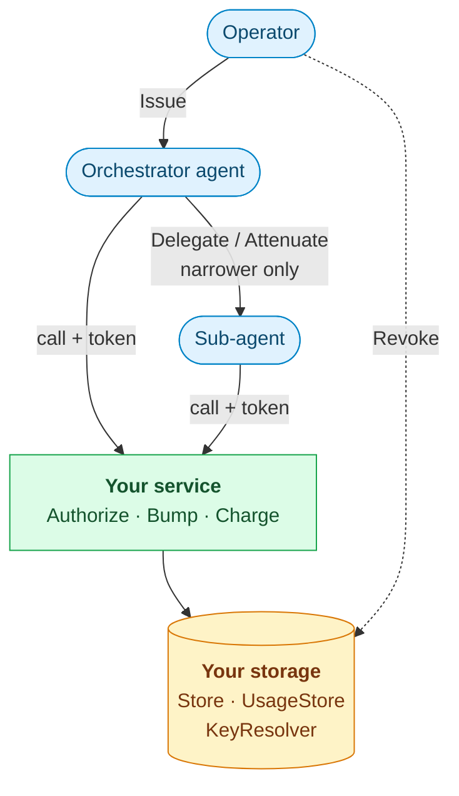

# limes

[](https://github.com/oleg-tkachuk/limes/actions/workflows/ci.yaml)
[](https://github.com/oleg-tkachuk/limes/releases/latest)
[](go.mod)
[](LICENSE)

Budgeted, delegable, individually revocable capabilities for agentic workloads,
as a Go library.

A capability is a short-lived signed token that carries its own authority:
which operations, on which resources, for how much money and how many
requests, until when, and on whose behalf. An agent can hand a sub-agent a
strictly narrower copy — through the issuer, or offline as a Biscuit block
with no call at all — every charge counts
against the whole delegation chain, and any capability can be revoked
mid-flight along with everything delegated from it.

The module ships the primitive and its contracts; you supply the storage. Its
resolved dependency graph holds no database driver and no storage SDK, and
`memstore`, an in-memory implementation, is enough to start.

*Limes* was the fortified frontier of the Roman Empire — a line that marks how
far authority reaches ([Wiktionary](https://en.wiktionary.org/wiki/Limes),
[Wikipedia](https://en.wikipedia.org/wiki/Limes_(Roman_Empire))).



## Install

```bash
go get github.com/oleg-tkachuk/limes@latest
```

## Five minutes

Setup errors are dropped below for brevity; each constructor returns one.

```go
ctx := context.Background()
tenantID, runID := uuid.New(), uuid.New() // github.com/google/uuid
key, _ := limes.GenerateKey()
kid, pub, priv := key.KeyID, key.Public(), key.Private

records, _ := memstore.NewStore(memstore.StoreConfig{}) // your Store
usage, _ := memstore.NewUsageStore(memstore.UsageStoreConfig{Records: records})

signer, _ := limes.NewSigner(limes.SignerConfig{KeyID: kid, Key: priv})
issuer, _ := limes.NewIssuer(limes.IssuerConfig{
    Signer: signer, Store: records, IssuerName: "my-issuer",
})
keys, _ := jwks.NewStatic(jwks.StaticConfig{Keys: map[string]ed25519.PublicKey{kid: pub}})
verifier, _ := limes.NewVerifier(limes.VerifierConfig{
    Keys:           keys,
    Revocations:    records,
    TrustedIssuers: []string{"my-issuer"},
})

issued, _ := issuer.Issue(ctx, limes.IssueRequest{
    IssuedBy: limes.Principal{Subject: "operator@example.com"}, // who asked
    Subject: limes.Principal{
        Type: limes.PrincipalTypeAgent, TenantID: tenantID,
        Subject: "research-orchestrator",
        Agent:   &limes.AgentPrincipal{AgentType: "my-agent", RunID: runID},
    },
    Audience: []string{"my-service"},
    TTL:      15 * time.Minute,
    Caveats: limes.Caveats{
        Ops:              []limes.Op{limes.OpGet, limes.OpShare},
        ResourcePrefixes: []string{"corpus/public/"},
        Requests:         limes.RequestCeiling{Max: 500},
        Budget:           limes.BudgetCeiling{Max: limes.MustParseAmount("25.00"), UnitCode: "USD"},
    },
})

// On every call: verify locally and enforce the caveats in one step, then meter.
granted, err := verifier.Authorize(ctx, limes.AuthorizeRequest{
    Verify: limes.VerifyRequest{Token: issued.Token, Audience: "my-service"},
    Check:  limes.CheckRequest{Op: limes.OpGet, Resource: "corpus/public/report.pdf"},
})
if err != nil {
    return err // a refusal, e.g. limes.ErrResourceNotAllowed outside corpus/public/
}
subject := granted.MeterSubject()
if _, err := usage.Bump(ctx, meter.BumpRequest{Subject: subject}); err != nil {
    return err // limes.ErrRequestLimitExceeded past the 500th request
}
if _, err := usage.Charge(ctx, meter.ChargeRequest{
    Subject: subject, Amount: limes.MustParseAmount("0.35"),
}, nil); err != nil {
    return err // limes.ErrBudgetExceeded past 25.00, with nothing counted
}
```

`IssueRequest` requires `Subject` with its `TenantID`, `IssuedBy` (a
`Subject` at least), `Audience` and `Caveats`; `TTL` defaults to fifteen
minutes. `issued.Token` is what the agent carries; `issued.Capability` is the
record you keep for audit. `verifier.ErrorResponse(ctx, err, limes.AuthSchemeBearer)`
turns a refusal into the HTTP status, `WWW-Authenticate` challenge and problem
body to answer with.
`go run ./quickstart` in [examples/](examples) runs issue, authorize, delegate,
meter and revoke end to end; the other examples there take each step on its
own, pgstore included, logging what happens.

## What it does

| Feature | What it does |
|---|---|
| **Verify** | Local Ed25519 JWT verification (`alg: Ed25519`, RFC 9864) against a resolved key — static, or an issuer's JWKS fetched by `jwks.Remote`, which revalidates by ETag and honours `Cache-Control`. Claims are read strictly: no unknown or duplicate member, integers within I-JSON's range. Rejections match sentinel errors (`errors.Is`) in families — `ErrUnauthenticated` over `ErrInvalidToken` and `ErrProofOfPossession` — and kinds that must not tell an attacker which check failed share `ErrInvalidToken`. |
| **Enforce** | `Authorize` verifies and checks every stateless caveat in one call: allowed ops, resource prefixes matched at `/` boundaries (a `.` or `..` segment never matches), idempotency keys for writes, tainted reads, source networks. Request and budget limits are the `Meter`'s. |
| **Delegate** | `Issuer.Delegate` issues a child that may only be narrower — operations, resources, limits and audience; anything wider is `ErrDelegationTooWide`. Its validity window is fitted inside the parent's: a TTL past the parent's expiry is clipped to it, and a `NotBefore` before the parent's start is raised to it. The child counts in the parent's unit; naming another is `ErrUnitCodeMismatch`, a conflict (`ErrConflict`, 409). The parent must allow `OpShare`, or the delegation is `ErrOpNotAllowed`, and an expired or revoked parent delegates nothing. |
| **Attenuate offline** | The Biscuit v3 form of a capability can be narrowed by its holder with no key and no network; each copy can get its own limits — as many copies with limits as the quota signed in the token (`Caveats.Copies`) allows across the delegation chain — and be revoked on its own. |
| **Bind to a key** | RFC 9449 DPoP: `Verify` refuses a key-bound capability without a fresh proof from that key, and, given the scheme it came under, one not presented under `DPoP`; server nonces (`dpop.HMACNonces`) work across replicas without shared state. |
| **Meter** | Requests count against the capability, every ancestor and each Biscuit copy with limits presented; spend against those and the tenant, atomically with your own side effect. Each copy with limits of its own counts against the copy quota of the capability and of every ancestor. Reserve an estimate, settle the actual cost, refund a charge. Amounts are exact integers of billionths of an ISO 4217 unit. `otelmetric.Instrument`, a module of its own, adds OpenTelemetry instruments. |
| **Revoke** | One call stops a capability and everything delegated from it; verifiers learn of it within a cache TTL, or at once on `Clear`, which `pgstore.RevocationWatcher` calls on every revocation; `otelmetric.InstrumentRevocationCache` exports the cache's counts. |
| **Report** | `LedgerReader.SumCharges` sums the charges of one tenant or of every tenant over a period by unit, whole or by UTC hour, day, ISO week or month, grouped by any of tenant, operation, actor and capability and filtered by them, the largest first. `RecordCensus.CountRecords` counts capability records — active, expired, revoked, delegated, expiring soon — for one tenant or all, by tenant and principal type. `RecordLister.ListRecords` lists one tenant's records, each with its disposition by the census's rules, filtered by principal type, subject or subject prefix and disposition, oldest or newest first; `RecordListingReader.GetRecordListing` reads one record with its disposition by the same rules. |
| **Answer refusals** | `ErrorResponse` maps a refusal to its status, an RFC 6750 / RFC 9449 `WWW-Authenticate` challenge and an RFC 9457 problem body, without the error's own text. |

You implement `Store` and a `KeyResolver`, which `jwks.Static` and
`jwks.Remote` already are, and, to meter, `meter.UsageStore` — or use
`memstore`, or `pgstore` over PostgreSQL — and check your implementation from
its own tests with `storetest`, `metertest` and `jwkstest` (`dpoptest` for a
DPoP replay cache or nonce source). Metering lives in the package `meter`, so
a service that only verifies tokens never imports it. A charge runs your
callback inside the store's transaction — `pgstore.TxFrom` reads it from the
callback's context — so it can commit together with, say, an outbox write.
The transaction stays the store's: the callback writes through it and never
commits or rolls it back (`pgstore.ErrChargeTransaction`), and it closes when
the callback returns.
Optional contracts serve one feature each: `BiscuitRevocationStore` and
`meter.CopyUsageReader` for Biscuit copies, `meter.LedgerReader` for billing
reads, `RecordCensus` for a census of records, `RecordLister` to list a
tenant's records and `RecordListingReader` to read one — `RecordReporter`
is both, and `memstore.NewCensus` and `pgstore.NewCensus` return the one
`Census` that serves all three — and `TenantRecordEraser` and
`meter.TenantUsageEraser` to remove a tenant.

## Guarantees

- **Charges are atomic.** A failed side effect, or a rejection by any
  ceiling, leaves every counter and the ledger untouched, so a retry is safe.
- **Delegation and attenuation never widen.** A fuzz test
  (`FuzzNarrowsNeverWidens`) checks that whatever `Narrows` accepts reaches no
  resource the parent cannot; an offline Biscuit block that asks for more
  invalidates the token.
- **A bound token needs its key**, and its children stay bound.
- **Keys never reach a log.** A signing key is held as a `SealedKey`
  (`SealKey`) and HMAC nonce keys as `dpop.NonceKeys` (`dpop.SealNonceKeys`):
  under any format verb, in JSON and in slog they print redacted, and both
  keep a copy, so the caller may clear its own.
- **The token format is pinned.** Golden fixtures in `testdata/` fail CI on any
  wire-format drift, because tokens outlive deployments.
- **No hidden dependencies.** `isolation_test.go` fails if a database driver,
  an object-storage SDK, a Redis client or OpenTelemetry enters the resolved
  dependency graph.
- **The root module's tests need nothing**: no database, no network, no
  container. `pgstore`'s run against PostgreSQL in a container, and
  `redisreplay`'s against miniredis and, in CI, a real Redis.

## Performance

Checking a token is mostly checking its Ed25519 signature: on an Apple M3 Max
core, `Verify` of a JWT takes about 39µs, of which the signature is 33µs, and
`Authorize` adds a microsecond or two. A Biscuit takes about 92µs, and each
attenuation block another signature's worth; a DPoP proof another signature.
A cached revocation answer takes about 45ns, and the verifier scales with the
processors: from four at once, a `Verify` comes out every 10µs. With
`pgstore`, a charge is a transaction of a few statements, 1.4–3ms against
PostgreSQL on the same host, and one tenant's charges commit one at a time —
the price of a tenant ceiling that is never crossed — so some 350–700 a
second for one tenant, while different tenants' run side by side.

The benchmarks behind these numbers are `bench_test.go` and
`pgstore/bench_test.go`, beside `otelmetric/bench_test.go` for what the
instruments add; a weekly workflow runs them on this commit and on the
newest release, taking turns on one runner, and soaks `pgstore` under
concurrent workers ([CONTRIBUTING](.github/CONTRIBUTING.md)).

## Versioning

Releases are `vX.Y.Z` tags, cut from Conventional Commits on `main` once CI
has passed: `feat` is a minor; `fix`, `perf` and `security` a patch. The module
is pre-1.0, so a breaking change is a minor too — **the Go API may change
between minor versions**; read the release notes, which list breaking changes
first, before bumping.

A release is not cut for every merge. It is cut once enough commits have
gathered since the last one — three that cut a minor, or five that cut a
patch — or at once for a breaking change or a `security` fix
([.github/release/release-policy.json](.github/release/release-policy.json)),
or whenever the Release workflow is run by hand. Run by hand with the
`prerelease` channel, it tags a release candidate, `vX.Y.Z-rc.N`, of what the
next release would be.

`redisreplay`, `pgstore` and `otelmetric` are modules of their own, each with
a release line of its own — `redisreplay/vX.Y.Z`, `pgstore/vX.Y.Z`,
`otelmetric/vX.Y.Z` — cut by the same
rules from the commits that touch it, plus one: a module's own `build`
commit, such as `build(pgstore): bump pgx`, is a patch of it, and is released
at once; so is the release workflow's `build(limes): require limes vX.Y.Z`,
for each module whose `go.mod` it raises. A
commit releases, by its type, each module whose files it changes; one scoped
`pgstore`, `redisreplay` or `otelmetric` never releases limes, breaking or not.

The token wire format — claims, `typ: limes-cap-v6+jwt`, the Biscuit facts —
is a separate promise: a token is a credential that outlives the process that
issued it, so the format changes only as a deliberate breaking change that
moves the version in `typ`, with the golden fixtures regenerated in the same
commit. A verifier refuses a token of a version it does not accept
(`VerifierConfig.AcceptTokenTypes`) outright, rather than read its claims
under the wrong schema. A new version ships so: verifiers accept it
first (`AcceptTokenTypes` takes every version the package reads), and
issuers mint it after (`SignerConfig.TokenType`), so no token in flight is
refused during the change. Tokens are signed with Ed25519 throughout 1.x; another
algorithm would be another token version, never a runtime choice.

The conformance suites — `storetest`, `metertest`, `dpoptest`, `jwkstest` —
may gain checks in any release: a check of a promise the contract already
made is the suite finding a bug in a store, not a break of the API. An `Env`
written for an earlier release still compiles; a new optional field skips
its checks while unset.

## Documentation

| Document | Covers |
|----------|--------|
| [docs/guide.md](docs/guide.md) | each concern in turn: verification, caveats, delegation, DPoP, Biscuit, metering, revocation, storage contracts, key rotation |
| [docs/standards.md](docs/standards.md) | the RFCs implemented — JWT, DPoP, JWKS, HTTP challenges and problem details — the choices made within them, and the OAuth standards deliberately left out |
| [docs/diagrams.md](docs/diagrams.md) | the contract boundary, a capability's lifecycle, the verification gates, delegation, Biscuit copies, the charge path, revocation |
| [docs/migration.md](docs/migration.md) | every breaking change from v0.3.0 on, of limes and of pgstore, release by release, as what it was and what it is now |
| [docs/api-review-v1.md](docs/api-review-v1.md) | the review of the API before 1.0: each finding, the decision taken and whether it is done |
| [docs/adr/](docs/adr/) | architecture decision records: what was decided about the code behind the API, and why |
| [CONTRIBUTING.md](.github/CONTRIBUTING.md) | building, testing and how a change lands |
| [SECURITY.md](.github/SECURITY.md) | reporting a vulnerability |

## Layout

| Path | Holds |
|------|-------|
| [`/`](.) | the `limes` package: issuer, verifier, caveats, Biscuit, contracts |
| [meter/](meter) | metering: request and spend counters, holds, tenant budgets and the charges ledger, against a verified capability's ceilings |
| [jwks/](jwks) | key sets (RFC 7517): the JWKS document and handler, remote and static key resolvers |
| [dpop/](dpop) | proof of possession (RFC 9449): signing and checking proofs, replay cache, server nonces |
| [inspect/](inspect) | reading a token without verifying it, for tooling |
| [memstore/](memstore) | the in-memory reference implementation of every storage contract |
| [pgstore/](pgstore) | the reference PostgreSQL store, a module of its own: `Store`, `BiscuitRevocationStore`, `meter.UsageStore`, `meter.CopyUsageReader`, a `Ledger`, a `Census` and both tenant erasers under row-level security per tenant, with `EraseTenant` and a `RevocationWatcher`; held to storetest and metertest; released as `pgstore/vX.Y.Z` |
| [redisreplay/](redisreplay) | a `dpop.ReplayCache` over Redis, a module of its own, for verifiers behind several replicas; released as `redisreplay/vX.Y.Z` |
| [otelmetric/](otelmetric) | OpenTelemetry instruments around a `meter.UsageStore` and a `RevocationCache`, a module of its own so limes resolves no OpenTelemetry; released as `otelmetric/vX.Y.Z` |
| [internal/](internal) | the module's own shared packages, not importable from outside it: JOSE pieces (`jose`), HTTP header names (`httpx`), RFC 3986 URI normalisation (`rfc3986`), access to unexported root internals for sibling packages (`link`), the sharded TTL cache behind `RevocationCache` (`ttlcache`), and field coverage and per-check deadlines for the conformance suites (`fields`, `watchdog`) |
| [storetest/](storetest), [metertest/](metertest), [dpop/dpoptest](dpop/dpoptest), [jwks/jwkstest](jwks/jwkstest) | conformance suites to run from your own implementation's tests |
| [examples/](examples) | runnable programs: the five-minute walkthrough (`quickstart`), and one topic each, logging every step to stdout — issuing and verifying, delegation, metering, and pgstore over PostgreSQL; a module of its own, never released. The Go documentation of every package carries `Example` functions for its calls; pgstore's compile without a database and do not run |
| [testdata/](testdata) | golden tokens, and the Biscuit vocabulary and cases shared with SDKs in other languages |
| [tools/](tools) | the developer tools, pinned in modules of their own and run with `go tool -modfile=tools/go.mod` (yq: `tools/yq/go.mod`, golangci-lint: `tools/golangci-lint/go.mod`) |

## License

Apache-2.0 — see [LICENSE](LICENSE) and [NOTICE](NOTICE).
