# Diagrams

Drawn from the code of this module. The behaviour is explained in
[README.md](../README.md), [guide.md](guide.md) and the package documentation;
the labels are exported names, so a renamed type shows up as a stale label.

Colours: blue for callers, green for what this module ships, amber for the
contracts a consumer implements and the stores behind them, grey dashed for
optional pieces, pink for things outside the process and for errors.

## Contract boundary

The module ships the primitive and its contracts; the consumer supplies the
storage behind them, or takes a store this repository ships: `memstore` in
memory, or one of the nested modules, each with its own `go.mod` and tag line
so the root module resolves no driver, SDK or Biscuit library:

- `pgstore` — every store contract over PostgreSQL, with row-level security,
  and a `dpop.ReplayCache`;
- `redisreplay` — a `dpop.ReplayCache` over Redis;
- `otelmetric` — OpenTelemetry instruments around a `meter.UsageStore` and a
  `RevocationCache`;
- `exchange` — OAuth 2.0 token exchange (RFC 8693) in front of an `Issuer`;
  `exchange/jwtverify` verifies JWT subject tokens;
- `biscuit` — the Biscuit form (`biscuit.Form`, a `TokenForm`) and offline
  `Attenuate`.

Every consumer needs a `Store`, which is also the `RevocationLineageLookup` a
verifier asks, a `KeyResolver` and, to meter, a `meter.UsageStore`. The rest
are optional:

| Contract | Needed by a consumer that |
|---|---|
| `BiscuitRevocationStore`, `meter.CopyUsageReader` | accepts the Biscuit form |
| `dpop.ReplayCache`, `dpop.Nonces` | binds capabilities to keys |
| `meter.LedgerReader`, `meter.LedgerHousekeeping` | bills or reports from the charges ledger, and bounds it |
| `RecordCensus`, `RecordLister`, `RecordListingReader` | reports on records |
| `BulkRevoker`, `meter.MatchingReleaser` | revokes by user, client, session, agent run or subject issuer, and frees the holds that stopped |
| `meter.Leaser` | leases budget to a capability, so its charges lock no ancestor's counters |
| `meter.TenantReservationLister` | lists the holds behind a tenant's reserved amount |
| `ExchangeStore` | exchanges each subject token for one capability |
| `TenantRecordEraser`, `meter.TenantUsageEraser` | removes a tenant |

`storetest`, `metertest`, `dpop/dpoptest` and `jwks/jwkstest` check an
implementation against its contract from its own tests, the optional ones
included when the store implements them, and bound every check by
`CheckTimeout`, so a store that deadlocks fails the check instead of hanging
the run.

```mermaid
flowchart LR
    caller(["Consumer service<br/>orchestrator · tool · API"])

    subgraph mod ["limes (this module)"]
        direction TB
        issuer["<b>Issuer</b><br/>Issue · Delegate · Reissue · Biscuit"]
        signer["<b>Signer</b><br/>NewSigner · SealKey → SealedKey · JWT Ed25519"]
        narrows["<b>Narrows</b><br/>child ⊆ parent"]
        verifier["<b>Verifier</b><br/>Authorize · Verify · Introspect · BiscuitCopy<br/>ErrorResponse · DPoPNonce"]
        caveats["<b>Caveats</b><br/>Check · CheckSource · AllowsResource"]
        cache["RevocationCache<br/>capabilities · Biscuit copies<br/>TTL · bounded per kind · single-flight<br/>sharded, a hit read-locked<br/>NewSignal · Clear · ClearRevoked · Sweep · Stats<br/>TTL, or SyncedTTL while its signals listen"]
        static["jwks.Static<br/>SetKey · RemoveKey"]
        remote["jwks.Remote<br/>ETag · Cache-Control · MaxStale<br/>held keys served, refreshed behind"]
        dpop["dpop.Verifier<br/>VerifierConfig.DPoP · dpop.Sign"]
        suites["storetest · metertest<br/>dpoptest · jwkstest<br/>conformance suites · CheckTimeout"]
        jwksh["jwks.NewHandler<br/>ETag · max-age"]
        nonce["dpop.HMACNonces<br/>stateless DPoP nonces · SealNonceKeys"]
        revoker["<b>Revoker</b><br/>Revoke · RevokeMatching · RevokeBiscuit<br/>logs each, clears this process's cache"]
    end

    subgraph contracts ["contracts the consumer implements"]
        direction TB
        store["<b>Store</b> = IssuanceStore + RecordReader + RevocationStore<br/>Insert · IsRevoked · GetRecord · Revoke<br/>Purge · ListByPrincipal<br/>RevocationLineageLookup: RevocationLineage → RevocationAnswer"]
        usage["<b>meter.UsageStore</b><br/>Meter = RequestCounter: Bump<br/>+ BudgetMeter: Charge · Reserve · Settle · Refund · Release<br/>MeterReader: GetUsage · GetCharge · ChargeByRef · GetReservation · ListReservations<br/>TenantBudgets · UsageHousekeeping"]
        mext["<b>meter.Leaser · meter.MatchingReleaser<br/>meter.TenantReservationLister</b><br/>Lease · GetLease · SettleLease<br/>ReleaseMatching · ListTenantReservations"]
        keys["<b>KeyResolver</b><br/>PublicKey(kid)"]
        brev["<b>BiscuitRevocationStore</b><br/>IsBiscuitRevoked · RevokeBiscuit<br/>GetBiscuitRevocation"]
        cusage["<b>meter.CopyUsageReader</b><br/>CopyUsage(CopyUsageRequest{CapabilityID, RevocationIDs})<br/>→ CopyUsageResult{Copies}"]
        replay["<b>dpop.ReplayCache</b><br/>Seen(ctx, ReplayEntry) · MemoryReplayCache ships"]
        nonces["<b>dpop.Nonces</b><br/>Nonce · Valid"]
        ledger["<b>meter.LedgerReader · meter.LedgerHousekeeping</b><br/>SumCharges(SumChargesRequest) → Page[ChargeSum]<br/>one tenant or every tenant · by unit · bucket none/hour/day/week/month<br/>GroupBy tenant · op · actor · capability · Filter<br/>PurgeCharges(PurgeChargesRequest) → PurgeChargesResult"]
        census["<b>RecordCensus</b><br/>CountRecords(CountRecordsRequest) → Page[RecordCount]<br/>one tenant or all · by tenant · principal type<br/>active · expired · revoked · delegated · expiring soon"]
        lister["<b>RecordLister · RecordListingReader</b><br/>ListRecords(ListRecordsRequest) → Page[RecordListing]<br/>one tenant or AllTenants · by principal type · subject · prefix · disposition<br/>oldest or newest first<br/>a cursor holds its tenant, order and filters (ErrCursorMismatch)<br/>GetRecordListing(id) → RecordListing"]
        erasers["<b>TenantRecordEraser · meter.TenantUsageEraser</b><br/>EraseTenantRecords · EraseTenantUsage"]
        bulk["<b>BulkRevoker · ExchangeStore</b><br/>RevokeMatching · ExchangedFor · ClaimExchange"]
    end

    impl[("memstore · your own store")]
    attenuate["<b>biscuit</b> (nested module)<br/>Form: a TokenForm · Attenuate offline, no key"]
    pg["<b>pgstore</b> (nested module)<br/>Store · BiscuitRevocationStore · erasers<br/>UsageStore · CopyUsageReader · Ledger · Census (count, list)<br/>ReplayCache · CheckSchema · EraseTenant · migrate.Run, Steps<br/>WithTenant · WithAllTenants · WithAllTenantsReadOnly<br/>ScopedIssuance · ScopedExchanges<br/>RevocationWatcher · row-level security"]
    rr["<b>redisreplay</b> (nested module)<br/>Cache: dpop.ReplayCache over Redis"]
    metering["<b>otelmetric</b> (nested module)<br/>Instrument: OTel counters · spend histogram<br/>InstrumentRevocationCache: cache Stats as observable counters and gauges<br/>WithMeterProvider · WithTenantAttribute"]
    pgdb{{"PostgreSQL"}}
    redis{{"Redis"}}
    jwks{{"Issuer JWKS endpoint"}}
    otel{{"OTel MeterProvider"}}

    caller --> issuer
    caller -- "ParseAuthorization" --> verifier
    caller --> caveats
    caller --> metering
    caller -. "Biscuit holder" .-> attenuate
    issuer --> narrows
    issuer --> signer
    issuer --> store
    verifier --> keys
    verifier --> cache --> store
    verifier -. "VerifierConfig.Biscuit" .-> cache --> brev
    caller -. "admin read" .-> cusage
    caller -. "billing read" .-> ledger
    caller -. "records report" .-> census
    caller -. "records listing" .-> lister
    caller -. "remove a tenant" .-> erasers
    caller -. "admin plane" .-> revoker
    revoker --> store
    revoker -. "ClearRevoked · Clear" .-> cache
    metering --> usage
    metering -. "Stats" .-> cache
    metering -. "metrics" .-> otel
    static -. "implements" .-> keys
    remote -. "implements" .-> keys
    remote -- "HTTP GET" --> jwks
    verifier -. "key-bound tokens" .-> dpop --> replay
    dpop -. "Nonces" .-> nonces
    nonce -. "implements" .-> nonces
    jwksh -- "serves" --> jwks
    suites -. "check" .-> store
    suites -. "check" .-> usage
    suites -. "check" .-> keys
    suites -. "check" .-> replay
    suites -. "check" .-> nonces
    suites -. "check" .-> brev
    suites -. "check" .-> cusage
    suites -. "check" .-> ledger
    suites -. "check" .-> census
    suites -. "check" .-> lister
    suites -. "check" .-> erasers
    suites -. "check" .-> bulk
    suites -. "check" .-> mext
    store --> impl
    usage --> impl
    mext --> impl
    brev --> impl
    cusage --> impl
    ledger --> impl
    census --> impl
    lister --> impl
    erasers --> impl
    bulk --> impl
    pg -. "implements" .-> store
    pg -. "implements" .-> usage
    pg -. "implements" .-> brev
    pg -. "implements" .-> cusage
    pg -. "implements" .-> ledger
    pg -. "implements" .-> census
    pg -. "implements" .-> lister
    pg -. "implements" .-> erasers
    pg -. "implements" .-> bulk
    pg -. "implements" .-> mext
    pg -. "implements" .-> replay
    pg --> pgdb
    rr -. "implements" .-> replay
    rr --> redis

    classDef client fill:#E0F2FE,stroke:#0284C7,color:#0C4A6E
    classDef role fill:#DCFCE7,stroke:#16A34A,color:#14532D
    classDef optional fill:#F1F5F9,stroke:#64748B,color:#334155,stroke-dasharray:5 4
    classDef store fill:#FEF3C7,stroke:#D97706,color:#78350F
    classDef external fill:#FCE7F3,stroke:#DB2777,color:#831843
    class caller client
    class issuer,signer,narrows,verifier,caveats,revoker role
    class cache,metering,static,remote,attenuate,dpop,suites,jwksh,nonce,pg,rr optional
    class store,usage,mext,keys,impl,brev,cusage,replay,nonces,ledger,census,lister,erasers,bulk store
    class jwks,otel,pgdb,redis external
```

The roles take narrower contracts than the stores implement:
`IssuerConfig.Store` is an `IssuanceStore` (Insert · IsRevoked),
`RevokerConfig.Store` a `RevocationStore`, `VerifierConfig.Revocations` a
`RevocationLineageLookup` — a plain `RevocationLookup` only under
`AllowUnrecorded` — and `BiscuitConfig.Revocations` a
`BiscuitRevocationLookup`. A `meter.Meter` counts against a
`limes.MeterSubject`, which only `VerifiedCapability.MeterSubject` or
`StoredMeterSubject` over a `RecordReader` builds, so a charge always names a
capability the verifier or the store vouched for.

Every read names what it reads — `Store.GetRecord`, `meter.MeterReader.GetUsage`,
`meter.TenantBudgets.GetTenantBudget` — so one type may implement `Store` and
`meter.UsageStore` together, or each apart as `memstore` does. A store puts
its transaction in the context `Charge` and `Settle` hand `onCharged`, and
`Refund` hands `onRefunded`, read through its own accessor (`pgstore.TxFrom`);
the module never names a transaction type, so it has no database dependency.

## Lifecycle of a capability

One orchestrator, one sub-agent, one service. Every call carries a token; the
service verifies it locally, enforces the caveats, then meters the call.

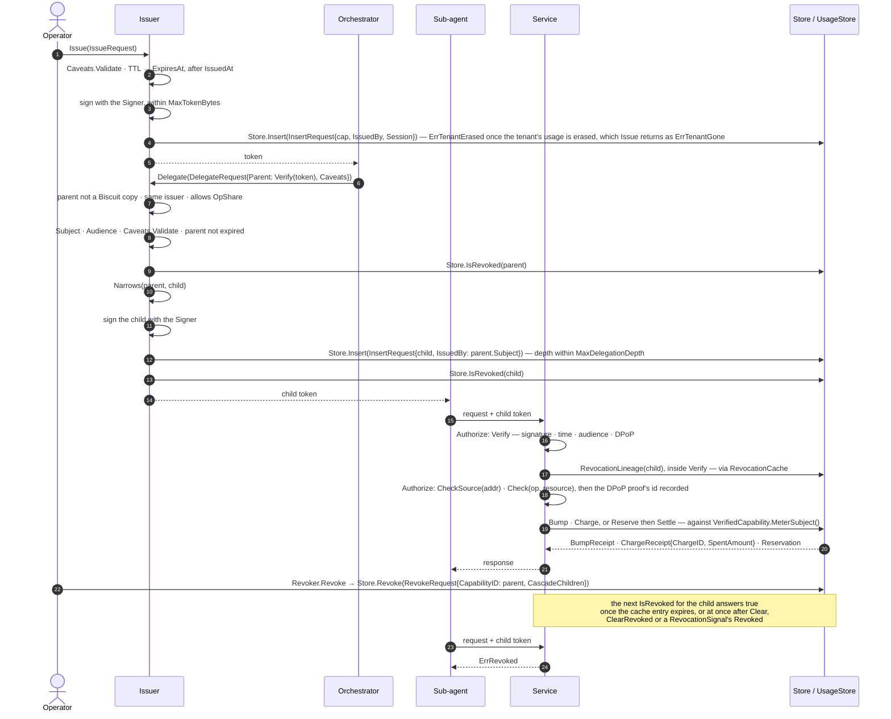

## Verification gates

`Verifier.Verify` reads nothing from the claims until the signature over them
has verified, checks a key-bound capability's proof of possession before any
lookup, and asks the revocation store only after every check that needs no
I/O. A copy with limits of its own is then refused at a verifier without
`MeterCopies`, `Authorize` checks the caveats, and only a request accepted
after all of that has its proof's id recorded in the replay cache: that room
is shared by every copy of the capability, so a revoked token, or a request a
caveat refuses, spends none of it.

The revocation lookup is `RevocationLineage`, which tells a capability not on
record from one not revoked: the first is `ErrUnrecorded`, unless
`VerifierConfig.AllowUnrecorded` has the verifier ask `IsRevoked` and read it
as not revoked.

Every refusal is a sentinel the caller maps to its own transport status, or
hands to `ErrorResponse`. A dependency that cannot answer is no refusal: an
unreachable JWKS is `jwks.ErrUnavailable` and a failed revocation lookup
`ErrRevocationUnavailable`, both 503; a key resolver failing otherwise, a
replay cache or a nonce source returns its error wrapped, 500; and a
key-bound capability at a verifier with no `dpop.Verifier` is
`ErrProofUnsupported`, the deployment's fault, 500.

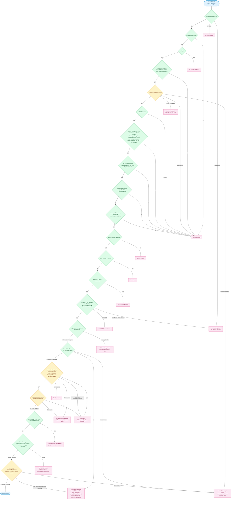

An unknown kid, an untrusted issuer, a kid bound to another issuer and a
missing tenant all match `ErrInvalidToken`; an unknown kid also matches
`jwks.ErrUnknownKID`. With `jwks.Remote`, a kid the held set lacks while the
endpoint is failing, and a caller that gave up waiting with no set to serve,
are `jwks.ErrUnavailable` too. A failed revocation lookup keeps a code of
limes's when its error has one: a lineage too deep stays `ErrDelegationTooDeep`,
an `ErrRevoked`. The DPoP refusals and `ErrAuthSchemeMismatch` match
`ErrProofOfPossession` — the token may be genuine, the proof is what failed —
and every refusal of the credentials matches `ErrUnauthenticated`:
`ErrUnrecorded` among them, which is not `ErrRevoked`, and `ErrNoCredentials`
from `ParseAuthorization`.

A Biscuit goes through the same gates, around them. `BiscuitConfig.Form`
(`biscuit.Form`) opens it; its authority block seals an ordinary signed
token, which passes the gates from the header to the tenant; that token names
the key rooting the Biscuit's chain, which is checked next, and then each
attenuation block is folded in. The time window, the audience, the scheme and
the proof of possession — over the Biscuit as presented — apply once, to the
narrowed capability that comes out; then both revocation lists, the copy
counters, `Authorize`'s caveats and the proof's id, as for any token.

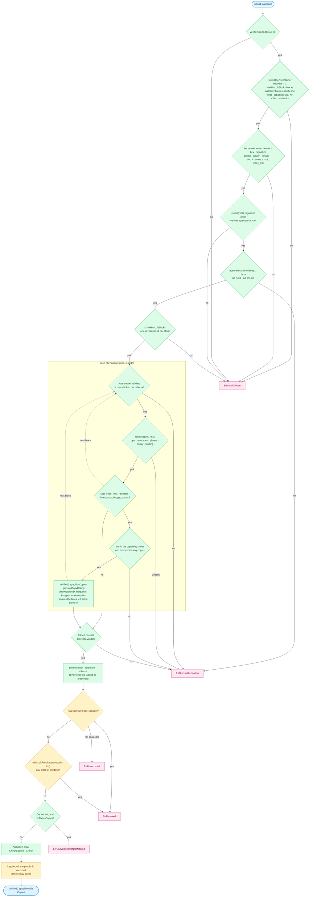

The sealed token presented on its own is refused, so it cannot be lifted out
to shed an attenuation. `ErrBiscuitAttenuation` matches `ErrInvalidToken`:
the token is not one this verifier accepts. `ErrCopyCountersNotMetered` does
not: the same token passes a verifier with `MeterCopies`, so the refusal is
the server's configuration, answered 500. A lookup that fails is
`ErrRevocationUnavailable`, as above.

## Proof of possession

A key-bound capability (`ConfirmationJKT` set) needs a DPoP proof (RFC 9449)
for every request; a verifier with no `dpop.Verifier` cannot check one and
answers `ErrProofUnsupported`. `dpop.Verifier.Verify` checks the proof in this
order and returns its own sentinel. `limes.Verifier` runs it in two parts:
`Check`, every step up to the nonce, before the revocation lookup, and
`Record`, the replay cache, last of all (see the gates above). It wraps each
refusal in `ErrProofOfPossession`, and passes a replay cache or nonce source
that cannot answer through as an outage. A token endpoint
(`exchange.Exchanger`) calls `CheckTokenRequest` instead: the same steps, but
the proof names no token (no `ath`) and may be by any key, which the issued
capability is then bound to.

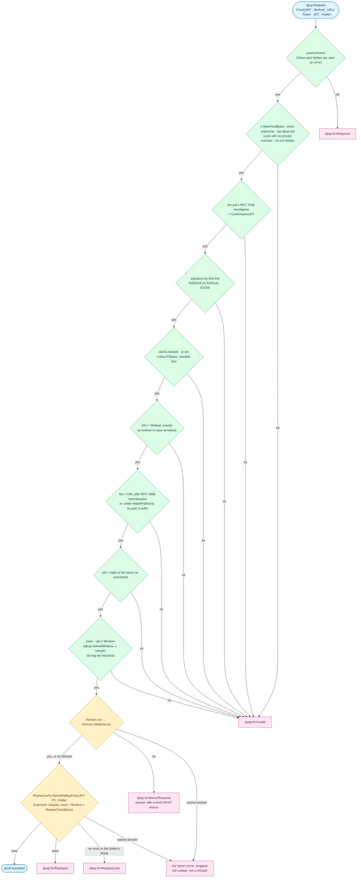

`dpop.HMACNonces` makes a nonce of its issuance time and an HMAC of it under
keys sealed with `dpop.SealNonceKeys`, so replicas holding the same keys
accept each other's nonces with no shared state, given clocks within
`dpop.HMACNonceClockSkew`. Every replay cache gives each holder — the
capability the token carries — a share of its own, so a holder past its share
has only its own proofs refused, with `dpop.ErrReplayQuota`, however many keys
its Biscuit copies are bound to. `dpop.MemoryReplayCache` keeps one process's
ids and, full, refuses rather than forgets; `redisreplay.Cache` and
`pgstore.ReplayCache` share one cache between replicas, in Redis or
PostgreSQL. A proof past `MaxProofBytes` is refused unread, and a `jti` past
`dpop.MaxJTIBytes` is refused as `dpop.ErrInvalid`, never stored.

## Answering a refusal

`Verifier.ErrorResponse` maps a refusal to how a protected resource answers
it, from the same table `ReasonOf` reads, and `WriteErrorResponse` writes it.
Each code's status, challenge and body are in [errors.md](errors.md#formats).

Any error limes returns has a `Code` too, a refusal or not. `ProblemOf`
builds the RFC 9457 body for an API that is not a protected resource;
`ErrorResponse` answers only refusals, and anything else as 500:

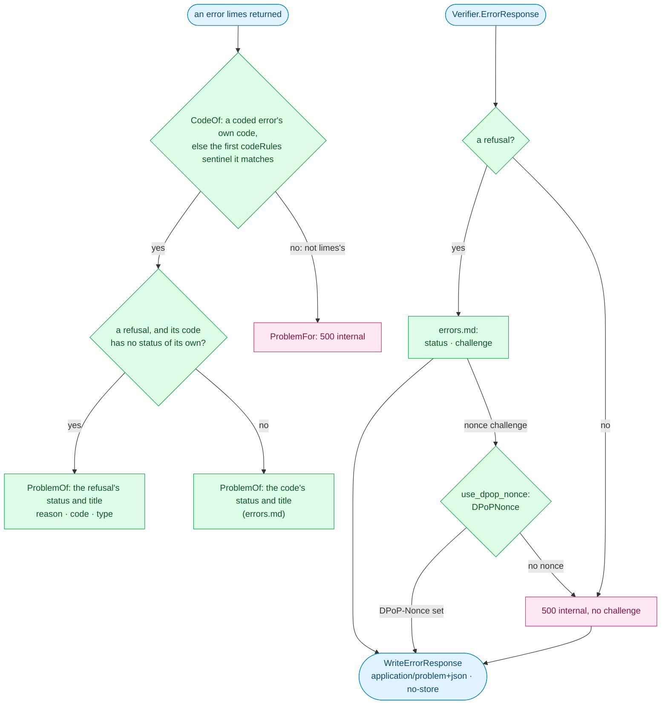

[errors.md](errors.md) lists every code with its status and sentinel.

## What the bearer may do

Verification proves the token is genuine. What the bearer may do with it is a
second step, evaluated per operation: `Authorize` runs `Verify`'s checks,
then `Caveats.CheckSource(ClientAddr)`, then `Caveats.Check`, and records a
key-bound token's proof only once both pass:

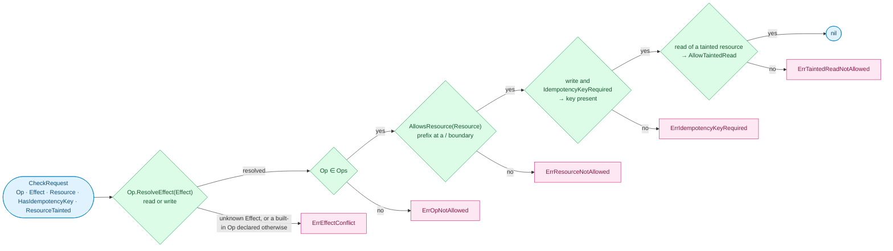

A built-in operation keeps its own effect; a consumer's operation is a write
unless its `Effect` says otherwise. `ErrEffectConflict` is a programming error,
not a caveat violation; each of the other four matches `ErrCaveatViolation`.
The source-address caveat is per connection and checked by
`Caveats.CheckSource`, which fails closed on an unknown address with
`ErrSourceIPNotAllowed`. Budget and request ceilings are stateful: the
`meter.Meter` enforces them.

## Delegation: attenuate, never escalate

`Issuer.Delegate` refuses a parent read from a Biscuit copy, one another
issuer minted, and one whose ops lack `OpShare` (`ErrOpNotAllowed`). It fills
what the request leaves out from the parent — tenant, audience, budget unit,
key binding, client, an agent's parent run, and the caveats under
`InheritCaveats` — refuses a parent that is expired or revoked, clamps the
child's window inside the parent's, and requires `Narrows(parent, child)` to
pass before anything is signed or persisted. A Biscuit's holder attenuates the
copy instead: a server-side child would be an ordinary token of the
capability, which revoking the copy would not reach and the copy's limits
would not bound.

```mermaid
flowchart TB
    req(["DelegateRequest<br/>Parent · Subject · Audience · Caveats or InheritCaveats<br/>TTL · NotBefore · ConfirmationJKT"])
    pid{"Parent.ID set"}
    copyp{"Parent not read from a Biscuit<br/>(FromBiscuit false, no Copies)"}
    own{"Parent.Issuer = this issuer"}
    share{"OpShare ∈ parent's Ops"}
    fill["unset tenant and audience taken from the parent<br/>InheritCaveats: the parent's caveats<br/>a budget naming no unit: the parent's"]
    valid{"Subject.Validate · agent ParentRunID, if set, the parent's run<br/>and RunID not it · audience valid<br/>Caveats.Validate · Requests allow a request · thumbprint valid"}
    alive{"parent not expired<br/>Store.IsRevoked(parent) = false"}
    clamp["ExpiresAt = min(now + TTL, parent.ExpiresAt)<br/>acts on behalf of the parent's principal<br/>unset binding and ClientID taken from the parent<br/>an agent's ParentRunID: the parent's run"]
    start["starts no earlier than the parent:<br/>NotBefore raised to the parent's start<br/>(its NotBefore, else IssuedAt)"]

    subgraph nar ["Narrows(parent, child)"]
        direction TB
        n0["Audience ⊆ parent's · ExpiresAt ≤ parent's<br/>starts no earlier than the parent<br/>same tenant · a bound parent's child stays bound"]
        n1["Ops ⊆ parent.Ops"]
        n2["every resource reachable by the parent<br/>exact-URI parent admits no child prefix"]
        n3["Requests within the parent's: any under Unlimited,<br/>a bound no higher under a bound"]
        n3c["Copies within the parent's, the same way"]
        n4["Budget.UnitCode = parent's<br/>(none taken as the parent's)"]
        n5["Budget within the parent's, the same way"]
        n6["AllowTaintedRead only if the parent has it<br/>IdempotencyKeyRequired never relaxed"]
        n7["SourceIPCIDR inside a parent network"]
        n0 --> n1 --> n2 --> n3 --> n3c --> n4 --> n5 --> n6 --> n7
    end

    sign["InsertRequest.Validate, then sign the child<br/>token within MaxTokenBytes"]
    persist{"Store.Insert(InsertRequest{child,<br/>IssuedBy: parent.Subject})<br/>no more than MaxDelegationDepth ancestors"}
    depth{"Store.IsRevoked(child) returns no error<br/>(a backstop for a store that does not refuse;<br/>the child is already on record)"}
    ok(["IssueResult{Capability, Token}"])

    wide["ErrDelegationTooWide"]
    unit["ErrUnitCodeMismatch"]
    noshare["ErrOpNotAllowed"]
    dead["ErrExpired · ErrRevoked<br/>ErrRevocationUnavailable when the lookup fails"]
    inval["ErrInvalidRequest · ErrInvalidCaveats"]
    stored["the store's error<br/>ErrDelegationTooDeep as ErrDelegationDepthExceeded<br/>ErrTenantErased as ErrTenantGone"]
    backstop["ErrDelegationDepthExceeded<br/>or ErrRevocationUnavailable"]

    req --> pid -- yes --> copyp -- yes --> own -- yes --> share -- yes --> fill --> valid -- yes --> alive -- yes --> clamp --> start --> n0
    n7 --> sign --> persist -- ok --> depth -- "no error" --> ok
    pid -- no --> inval
    copyp -- no --> inval
    own -- no --> inval
    share -- no --> noshare
    valid -- no --> inval
    clamp -- "negative TTL" --> inval
    start -- "window empty" --> inval
    alive -- no --> dead
    n4 -- differs --> unit
    nar -- widens --> wide
    sign -- "invalid, or too long" --> inval
    persist -- refused --> stored
    depth -- "error: too deep, or the lookup fails" --> backstop

    classDef client fill:#E0F2FE,stroke:#0284C7,color:#0C4A6E
    classDef role fill:#DCFCE7,stroke:#16A34A,color:#14532D
    classDef store fill:#FEF3C7,stroke:#D97706,color:#78350F
    classDef external fill:#FCE7F3,stroke:#DB2777,color:#831843
    class req,ok client
    class pid,fill,valid,copyp,own,share,clamp,start,sign,n0,n1,n2,n3,n3c,n4,n5,n6,n7 role
    class alive,persist,depth store
    class wide,unit,noshare,dead,inval,stored,backstop external
```

Narrowing bounds each child on its own. The tree as a whole is bounded at use:
every charge also counts against each ancestor, read from the ancestor's
stored record. A parent holding 25.00 that delegates 20.00 to each of two
workers can still spend 25.00 in total, not 40.00:

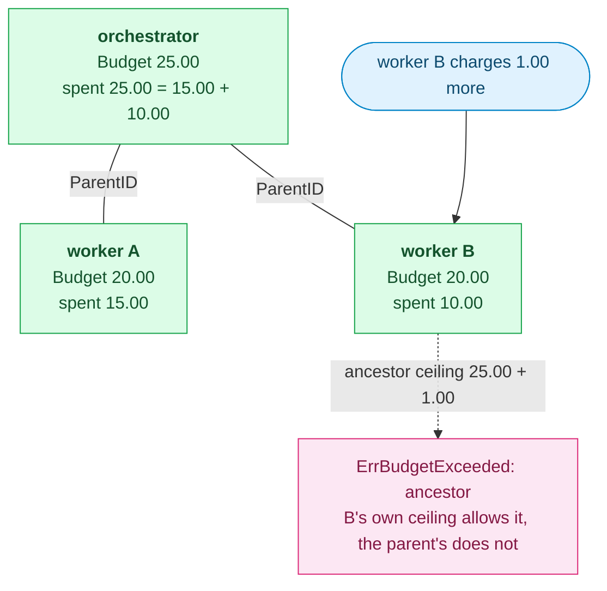

## Biscuit copies: one tree, revoked and counted by block

Every attenuation appends a block, and every block has a revocation id — its
signature. A copy carries the ids of every block above it, so an id names a
copy *and everything attenuated from it*. The same ids key both of the things
a holder's copy can have on its own: a revocation, and limits.

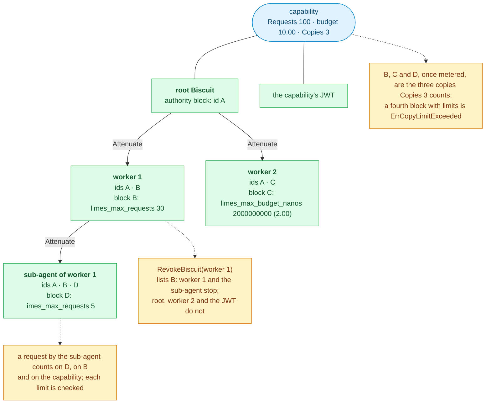

- **Revocation.** `BiscuitCopy` checks that a copy is genuine — its size, the
  sealed token's signature, issuer and tenant, and its chain and blocks — but
  not its expiry, audience, proof or revocation, since a copy can be revoked
  whatever its state; it names the capability and the last block's id, which
  `BiscuitRevocationStore.RevokeBiscuit` lists. Revoking the capability still
  stops every copy and the JWT.
- **Limits.** A block may set `limes_max_requests` and
  `limes_max_budget_nanos`, within every limit in force. The `meter.Meter`
  counts each under the block's id, beside the capability's own counters, and
  a charge or reservation records the ids it debited so a refund, settle or
  release returns to them; `meter.CopyUsageReader` reads the counters back.
  How many copies are counted is bounded by `Caveats.Copies`, a `CopyQuota`
  signed into the token, which no block changes. The quota covers the copies
  of the capability and of every capability delegated from it, kept as a
  running count on each capability's counters (`copies_under` in `pgstore`,
  migration 013), and the store's own bound,
  `meter.DefaultMaxCopiesPerCapability` (1024) unless configured, applies too.
  A copy past either is `meter.ErrCopyLimitExceeded`, an
  `ErrRequestLimitExceeded`. A copy's calls never go under a lease.
- **No delegation from a copy.** `Issuer.Delegate` and `Issuer.Biscuit`
  refuse any capability read from a Biscuit (`VerifiedCapability.FromBiscuit`)
  as `ErrInvalidRequest`; see the delegation section above.

## Charge: stage, then commit

Every amount on this path is `Nanos`, an `int64` count of billionths of the
unit, so each comparison and sum below is exact.

`meter.Meter.Charge` refuses a tenant whose usage was erased
(`ErrTenantErased`), replays a charge its `ExternalRef` already names, admits
each Biscuit copy it has not counted yet against the copy quota of the
capability and of every ancestor (`meter.ErrCopyLimitExceeded`), then checks
every ceiling — each Biscuit copy's, the capability's, each ancestor's and the
tenant's — and runs the consumer's side effect before anything commits. A
rejection at any stage, or a failing `onCharged`, leaves every counter and
the ledger as they were, so a retry after a rejection is safe. A charge under
a lease stops at the leaseholder instead; see
[Charging under a lease](#charging-under-a-lease).

A cost known only afterwards goes through a reservation instead. `Reserve`
holds an estimate against the same ceilings, and `Settle` charges the actual
cost along the same path, releasing the hold and deleting the reservation in
the same commit. Every ceiling counts open holds as well as spend, so two
callers cannot both hold the last of a budget. A settle takes its hold off
before it measures, so one at or below the hold fits every ceiling that holds
it — even one lowered or crossed since — and only an amount past the hold, or
an ancestor that does not hold it, is checked.

```mermaid
flowchart TB
    req(["ChargeRequest<br/>Subject (id · tenant · ceilings · unit · copy quota · copies) · Amount<br/>ExternalRef · Overrun"])
    sreq(["SettleRequest<br/>Subject · ReservationID · Amount · Overrun"])
    sval{"subject set, a unit named · Nanos.Validate · Overrun.Validate<br/>ReservationID not zero"}
    hold{"reservation open, unexpired,<br/>the subject's own, under the same copies"}
    val{"Nanos.Validate · Overrun.Validate · ValidateExternalRef<br/>subject set · a unit named"}
    erased{"tenant not marked erased<br/>(EraseTenantUsage)"}
    seen{"ExternalRef already charged<br/>to this capability"}
    same{"same Amount · UnitCode · TenantID<br/>· Biscuit copies"}
    lin{"capability on record<br/>lineage read: its ancestors still on record"}

    subgraph stage ["stage — compute, publish nothing"]
        direction TB
        cq{"each copy not counted yet: within the store's bound for the capability<br/>and the copy quota of the capability and of each ancestor,<br/>counted over its subtree (the copies under it)<br/>a settle's copies were counted at Reserve"}
        leased{"a Charge under OverrunPolicyReject, of no copy,<br/>and the capability or an ancestor holds an open lease"}
        c00{"Amount in the unit the capability, each ancestor and the tenant count in<br/>no counter, copies included, past MaxNanos"}
        c0{"each Biscuit copy, innermost first:<br/>spend + reserved + Amount ≤ its budget"}
        c1{"own spend + reserved + Amount ≤ Subject.Budget<br/>(ceiling from the verified token or stored record)"}
        c2{"each ancestor: spend + reserved + Amount<br/>≤ its Budget<br/>(ceiling from the stored record)"}
        c3{"tenant spend + reserved + Amount<br/>≤ TenantBudget.Ceiling<br/>(Unlimited until one is set)"}
        cb{"onCharged(ctx with the store's tx, Charged{Receipt})<br/>consumer's side effect in the same transaction"}
        cq -- yes --> leased -- no --> c00 -- yes --> c0 -- yes --> c1 -- yes --> c2 -- yes --> c3 -- yes --> cb
    end
    lpath["the lease path<br/>(Charging under a lease)"]
    leased -- yes --> lpath

    subgraph commit ["commit — all together"]
        direction TB
        w1["capability spend += Amount<br/>settling: its hold leaves reserved"]
        w2["each ancestor on the lineage as read now:<br/>spend += Amount"]
        w0["settling: each ancestor that held it<br/>and still has a row: its hold leaves reserved"]
        w3["tenant spend += Amount · settling: its hold leaves reserved<br/>(the row created, with no ceiling, if missing)"]
        w5["each copy's spend += Amount<br/>settling: its hold leaves reserved<br/>a new copy: counted under the capability and each ancestor"]
        w4["ledger row: ChargeID · TenantID · Amount · UnitCode · At<br/>Ancestors · copy ids · Op · Actor · ExternalRef<br/>ReservationID · Overrun · tenant period"]
        w6["settling: the reservation is deleted"]
    end

    ok(["ChargeReceipt{ChargeID, SpentAmount, Overrun, TenantID, UnitCode}"])
    replay(["ChargeReceipt{Replayed}<br/>the earlier charge; nothing moves"])
    refund["Refund(RefundRequest{ChargeID, Amount or Remaining}, onRefunded) → RefundReceipt<br/>returns spend to every counter the charge took it from;<br/>the tenant's only within the same accounting period;<br/>onRefunded runs inside, as onCharged does"]

    e0["ErrInvalidRequest (ErrInvalidAmount)<br/>ErrConflict (ErrUnitCodeMismatch) · meter.ErrCounterOverflow"]
    e1["ErrBudgetExceeded"]
    e2["ErrBudgetExceeded: ancestor"]
    e3["ErrTenantBudgetExceeded"]
    e4["the callback's error"]
    e5["meter.ErrReservationNotFound"]
    e6["meter.ErrExternalRefConflict"]
    e7["ErrNotFound · ErrDelegationTooDeep"]
    e8["ErrTenantErased"]
    e9["meter.ErrCopyLimitExceeded"]
    e10["pgstore.ErrChargeTransaction"]
    e11["meter.ErrSettleConflict"]

    req --> val -- ok --> erased -- no --> seen -- no --> lin
    erased -- yes --> e8
    seen -- yes --> same -- yes --> replay
    same -- no --> e6
    sreq --> sval -- ok --> hold -- yes --> lin
    lin -- yes --> cq
    cq -- "no, under any policy" --> e9
    lin -- no --> e7
    sval -- "invalid" --> e0
    sval -- "zero id" --> e5
    hold -- "settled by this subject,<br/>under the same copies" --> samt{"same Amount"}
    samt -- yes --> replay
    samt -- no --> e11
    hold -- "released · expired · another capability's<br/>· other copies" --> e5
    cb -- nil --> w1 --> w2 --> w0 --> w3 --> w5 --> w4 --> w6 --> ok
    ok -. "later" .-> refund
    val -- invalid --> e0
    c0 -- "no, OverrunPolicyReject" --> e1
    c1 -- "no, OverrunPolicyReject" --> e1
    c2 -- "no, OverrunPolicyReject" --> e2
    c3 -- "no, OverrunPolicyReject" --> e3
    cb -- error --> e4
    cb -- "pgstore: it ended the transaction" --> e10
    c00 -- no --> e0

    classDef client fill:#E0F2FE,stroke:#0284C7,color:#0C4A6E
    classDef role fill:#DCFCE7,stroke:#16A34A,color:#14532D
    classDef store fill:#FEF3C7,stroke:#D97706,color:#78350F
    classDef optional fill:#F1F5F9,stroke:#64748B,color:#334155,stroke-dasharray:5 4
    classDef external fill:#FCE7F3,stroke:#DB2777,color:#831843
    class req,sreq,ok,replay client
    class val,sval,erased,seen,same,samt,hold,lin,cq,leased,c00,c0,c1,c2,c3 role
    class cb,lpath optional
    class w1,w2,w0,w3,w5,w4,w6,refund store
    class e0,e1,e2,e3,e4,e5,e6,e7,e8,e9,e10,e11 external
```

`Bump` takes the same order for requests: the erased-tenant check, the copy
quota, the lease, then each copy's limit, the capability's and each
ancestor's. A reservation keeps its copies' budgets, so `Settle` checks them
without being handed them again; the subject settling must still carry the
same copies.

A settle rejected by a ceiling leaves the reservation in place, to be settled
lower or released with `Release`. Under `OverrunPolicyRecord` no ceiling
rejects: a check that fails marks the charge as an overrun and the stage goes
on, since the cost has already been incurred; the crossed ceiling then
refuses whatever follows under `OverrunPolicyReject`. A mismatched unit or a
counter past `MaxNanos` is refused even then: neither is a ceiling an overrun
may cross. A charge named by `ExternalRef`, or a settle of a reservation
already settled for the same amount, returns the earlier charge and moves
nothing; a settle for another amount is `meter.ErrSettleConflict`, and the
same `ExternalRef` with another amount, unit, tenant or Biscuit copy is
`meter.ErrExternalRefConflict`: another copy charges its own counters, which
the earlier receipt never touched.

Holds and housekeeping, in `memstore` and `pgstore` as the contract has them:

- `Reserve` checks the same ceilings — never overrun — and holds the amount
  on the capability, each ancestor, the tenant (creating its row) and each
  copy; `Release` and `ReleaseExpired` take it off again. A hold never settled
  lapses at its `ExpiresAt` — `meter.DefaultReservationTTL`, five minutes, by
  default, and never later than its capability's expiry — but keeps counting
  until `ReleaseExpired` runs, which errs towards refusing spend. A revoked
  capability's hold stays settleable until then, or until
  `meter.MatchingReleaser.ReleaseMatching` frees it after a bulk revocation.
  Under a `ReservationID` already held for the same request `Reserve` returns
  that hold, `Replayed`, and holds nothing more; for another request, or once
  settled, it is `meter.ErrReserveConflict`.
- `Refund` under a `RefundID` already on record for the same charge and
  amount returns the first receipt, `Replayed`; for another charge or amount
  it is `meter.ErrRefundConflict`. The id goes with its charge.
- `DeleteUsage` releases the capability's holds, and settles the leases of
  the capability and of those below it, before it drops its counters and its
  copies'; `PurgeOrphans` does the same for every capability no longer on
  record, a batch of `Limit` at a time: nothing could settle or release them
  afterwards. Either takes the dropped ids off the ancestor lists of the holds
  that remain. Each copy dropped stays counted against the copy quota of
  every ancestor, as its requests and spend do; `DeleteUsage` of an ancestor
  itself restarts that ancestor's count with its other counters.
- `SetTenantBudget` is guarded by `ExpectedVersion` (0 for a tenant with no
  ceiling yet; `meter.ErrTenantBudgetVersionMismatch` otherwise), refuses a
  new unit while anything is held in the old one, or spent in it unless
  `ResetSpend` closes that spend, and with `ResetSpend` settles the tenant's
  leases and opens a new accounting period, so a refund of an earlier
  period's charge leaves the new period's spend alone.
- A call that would settle a lease which keeps moving may be refused as
  `ErrConflict`, having moved nothing, for the caller to send again.

A store with transactions runs stage and commit inside one, and hands
`onCharged` a context carrying it, beside the receipt the call will return
(`Charged`); `onCharged` may be `nil`. A store without them hands on the
caller's context; `memstore` runs `onCharged` before it publishes anything,
`pgstore` once the ledger row is written, so that what `onCharged` writes can
refer to it, before the commit.

`pgstore` runs each call in one READ COMMITTED transaction and hands
`onCharged` that transaction through `TxFrom`, so a rejection or a failing
side effect rolls everything back. The transaction is `onCharged`'s only
while it runs: afterwards every call on it fails with `pgx.ErrTxClosed`.
`Commit` and `Rollback` on it return `pgstore.ErrChargeTransaction`, and so
does a charge whose `onCharged` ended the transaction with SQL of its own —
`COMMIT`, `ROLLBACK`, or either followed by `BEGIN`.

`Bump`, `Charge`, `Reserve`, `Settle` and `Release` first refuse a scope that
does not admit the subject's tenant, as `ErrScopeMismatch`, before any row is
read. Every call locks in one order, so two calls never wait on each other in
a cycle: the tenant's erase lock, shared, where the call takes one (`Bump`,
`Charge`, `Reserve`; an erase holds it alone); the reservation being settled
or released; the lineage's records `FOR KEY SHARE`, in one statement with the
walk; then the usage rows by capability id, the copies' rows by revocation
id, and last the tenant's aggregate row, then the ledger. A release of
several holds — `ReleaseExpired`, or `DeleteUsage` dropping a capability's —
locks every counter it will write before it writes any, in that same order.
A deadlock with a call of another release, during a rolling upgrade, is run
again once; a second is `ErrStoreUnavailable`.

The tenant's aggregate row is held until commit, so one tenant's charges,
holds, settles, refunds and releases commit one at a time, whatever their
capabilities (`pgstore`'s package documentation, Throughput) — with two
exceptions: a tenant with no ceiling counts in 64 stripes, each call in its
connection's, and locks no row (`Config.DisableTenantStripes` turns that off); and a
charge under a lease locks the lease's counters, not the tenant's. `Bump`
takes no tenant row. An `ExternalRef` is looked up again once the locks are
held, since a concurrent delivery may have committed in between; if one has,
the call rolls back and returns that delivery's receipt. A call holds one
connection, so a small pool serves as many calls at once as it has
connections.

### Charging under a lease

A `meter.Leaser` holds part of a chain's budget and requests for one
capability, so that its charges and bumps, and those of the capabilities
delegated from it, lock only the counters below the leaseholder and the
lease's balance, never an ancestor's or the tenant's
([ADR 0017](adr/0017-budget-leases.md)). What the lease spent reaches the chain
when it is settled.

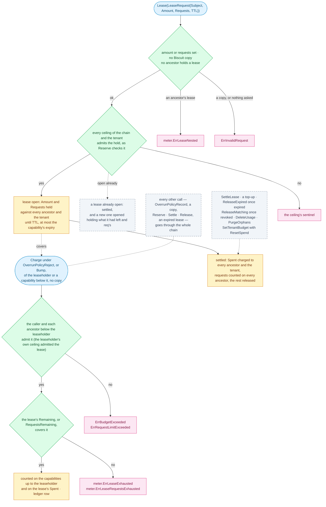

A refund of a charge taken under a lease returns to the lease while it is
open, and to the chain once it is settled. `pgstore`'s `Config.DisableLeases`
turns leasing off (`meter.ErrLeasingDisabled`); leases already open are still
charged under and settled.

## Revocation reaches the verifiers

Revocation is a write to the `Store`, made through a `Revoker` on the admin
plane, which logs it and clears its own process's `RevocationCache`;
verifiers elsewhere see it through `RevocationLineage`, which answers for the
whole delegation chain, behind their own cache.

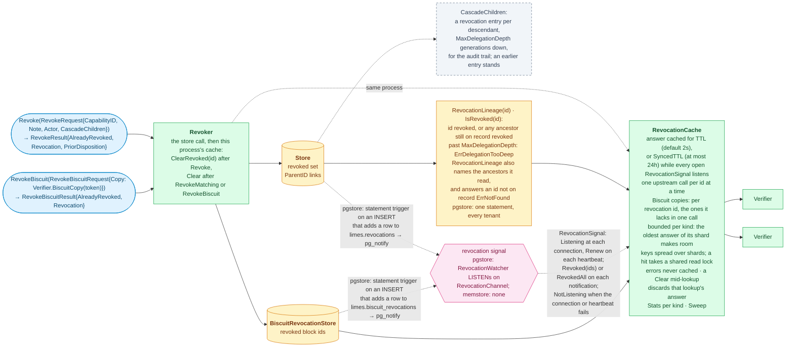

Revoking a capability stops everything delegated from it whether or not
`CascadeChildren` is set, because `IsRevoked` walks the ancestors; the flag
only adds the per-descendant entries that name each stopped capability. Without
a revocation signal, a verifier learns of a revocation within the cache TTL;
`pgstore`'s schema notifies a channel on every statement that writes a
revocation, naming each capability revoked whose parent has no revocation
entry, `MaxNotifiedRevocations` (100) to a notification and up to
`MaxNotifiedRevocationsPerStatement` (1 000) in all; a Biscuit copy's
revocation, a statement past that bound, or one revoking a capability the writer's
row-level security hides names none, and a statement whose capabilities'
parents were all revoked before notifies nothing. Its `RevocationWatcher`
passes them to each cache's `RevocationSignal` on each notification —
`Revoked(ids)`, or `RevokedAll` when it names none — says `Listening` after
each reconnect, which leaves every answer read before it on `TTL`, renews
its lease on each notification and heartbeat, and says `NotListening` when
the connection or its heartbeat fails, which puts the cache back on its
`TTL`, as a lease that lapses unrenewed does.

An answer cached for a descendant is also an answer about the revoked
ancestor: over a store that names each answer's ancestors, `ClearRevoked`
drops the revoked ids' answers and every one naming them among its
ancestors, and over any other it drops the cache whole. A lookup in flight whose answer
may predate the revocation — of a revoked id, or naming one among its
ancestors — is neither cached nor shared with later checks; every other is.
Revoked Biscuit copies travel the same way, on their own list but through the
same cache, which keeps each kind of answer apart; one `Clear` drops both.
`Stats` counts each kind's hits, misses, upstream lookups, evictions and
entries; the clears, whole and narrow (`Clears`, `NarrowClears`,
`ClearsWithoutLineage`); the signals' syncs and losses (`Synced`, `Syncs`,
`SyncsLost`, `LastSyncLoss`) and the notifications they passed (`Signals`,
`SignalsWhole`); and whether the upstream names lineage (`Lineage`).
`otelmetric.InstrumentRevocationCache` exports them all; `Sweep` drops
expired answers ahead of the lookups that would.

In `pgstore`, `Revoke` first takes the tenant's revoke lock alone — each
insert of a child shares it — then holds the target `FOR NO KEY UPDATE` and
marks it and every record below it revoked, a generation per statement; a
metered call's `FOR KEY SHARE` lineage lock conflicts with neither, so
charges neither wait for a revoke nor hold one back.
`Revoke` and `RevokeBiscuit` run under the caller's tenant —
a capability it cannot see is `ErrNotFound` — while `IsRevoked`,
`RevocationLineage` and `IsBiscuitRevoked` are each one statement calling a `SECURITY DEFINER`
function of the schema, which sees every tenant: the verifier asks before it
knows the token's. A revocation entry is deleted with its record, so once
`Purge` reaps an ancestor the walk no longer reaches it — by then it has
expired, and so has every descendant.

A verifier apart from the issuer resolves keys with `jwks.Remote`; its
caching and failure modes are in the [guide](guide.md#authorize-every-call).

## Revoking by user, client, session or agent run

A `BulkRevoker` revokes, in batches, every capability of one tenant that
matches each selector given — or, by client, session or subject issuer alone,
of every tenant. The session and the subject issuer are recorded at issuance
— an `exchange.Exchanger` takes them from the subject token's `sid` and
`iss`, a child from its parent — and are never claims. A
`meter.MatchingReleaser` then releases the holds the revocation stopped, and
settles their leases, which would otherwise count until they expire, by the
same selectors, so a release retried after its revocation went through needs
no list of tenants.

```mermaid
flowchart LR
    sess["IssueRequest.Session · SubjectIssuer<br/>exchange: the subject token's sid and iss<br/>a child: its parent's"]
    req(["RevokeMatchingRequest{TenantID or AllTenants,<br/>Subject · OnBehalfOf · ClientID · Session · RunID · SubjectIssuer,<br/>Note, Actor, Limit}"])
    val{"TenantID or AllTenants, not both · a selector<br/>AllTenants: ClientID · Session · SubjectIssuer alone<br/>Limit ≥ 0"}
    scope{"pgstore: the scope admits TenantID<br/>AllTenants: one that writes every tenant"}
    sel["the capabilities matching every selector<br/>with no revocation entry of their own<br/>tenant, id order · at most Limit (DefaultHousekeepingLimit)<br/>pgstore, AllTenants: at most 16 tenants a batch"]
    lock["pgstore: each tenant's revoke lock, in order"]
    write["a revocation entry each, in its tenant · Note · Actor"]
    desc["descendants stop through<br/>IsRevoked's lineage walk"]
    res(["RevokeMatchingResult{Revoked, Tenants, More}"])
    inval["ErrInvalidRequest"]
    mism["ErrScopeMismatch"]
    release["meter.MatchingReleaser.ReleaseMatching<br/>TenantID or AllTenants, the same selectors or CapabilityID<br/>open holds and leases of revoked matches and their descendants<br/>a live capability's hold kept"]

    req --> val -- yes --> scope -- yes --> sel --> lock --> write --> res
    res -. "then, to free the budget at once" .-> release
    sess -. "Session · SubjectIssuer selectors" .-> sel
    write -.-> desc
    res -. "More: call again" .-> req
    val -- no --> inval
    scope -- no --> mism

    classDef client fill:#E0F2FE,stroke:#0284C7,color:#0C4A6E
    classDef role fill:#DCFCE7,stroke:#16A34A,color:#14532D
    classDef optional fill:#F1F5F9,stroke:#64748B,color:#334155,stroke-dasharray:5 4
    classDef store fill:#FEF3C7,stroke:#D97706,color:#78350F
    classDef external fill:#FCE7F3,stroke:#DB2777,color:#831843
    class req,res client
    class val,scope role
    class sess,desc,release optional
    class sel,lock,write store
    class inval,mism external
```

## pgstore: a call under its tenant's scope

Every call of `pgstore` runs in a transaction that `Config.Scope` scopes
first; the default reads the scope a context carries. A call whose request
names a tenant is refused with `ErrScopeMismatch` when that scope does not
admit the tenant, before it reads a row, rather than answer as rows that are
not there. A call that writes is refused so under a read-only scope: before
the transaction under `WithAllTenantsReadOnly`, and once a `Config.Scope` of
the consumer's has run when it set `limes.all_tenants` to `read`. Row-level
security then binds every statement: `tenant_visible` for reads,
`tenant_writable` for writes. It binds the table owner too; `migrate.Run`
scopes each migration to every tenant and stops when it cannot. A superuser
or a `BYPASSRLS` role is never bound, so `CheckSchema` refuses with
`pgstore.ErrRuntimeRole` a connection whose current, session or login role is
one of those, can act as one, or owns anything in the schema. Only the
`migrate.Options.RuntimeRoles` may execute the schema's functions. Every
transaction is READ COMMITTED, whatever the database's default; over a pool,
a connection or a `ConnLender`, `BEGIN` and the scope go with the call's first
statement rather than costing a round trip of their own.

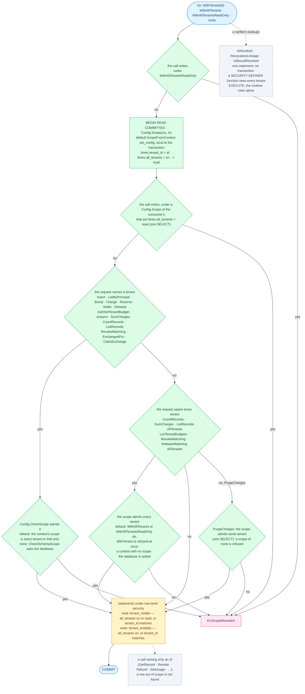

A consumer's own `Config.Scope` gets no check unless it also sets
`Config.CheckScope`; `CheckSchemaScope` serves one that sets the schema's own
settings.

## Erasing a tenant

`pgstore.Store.EraseTenant` removes a tenant in one transaction scoped
to it, and runs the consumer's `onErased` last in the same transaction, so the
consumer's rows of the tenant go with the store's or not at all. It locks in
the order the meter does, so it never waits on a meter call in a cycle, and
takes the tenant's revoke lock alone before its records, as `Revoke` does.

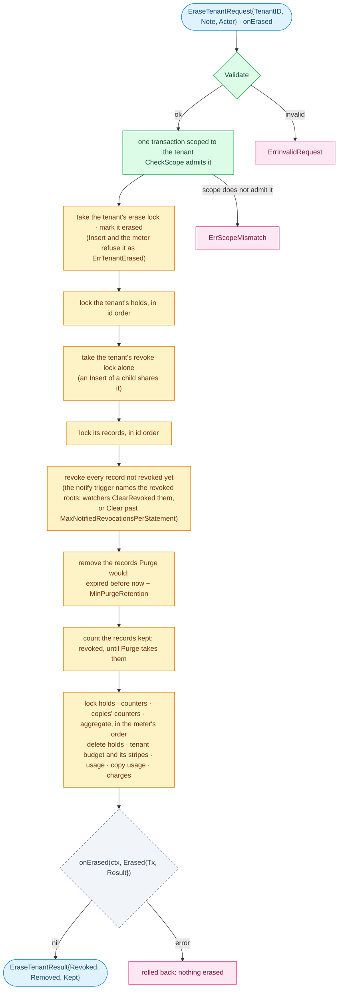

A record kept stays revoked: an id not on record is not revoked, so removing
a live record early would let its token through. The separate
`EraseTenantRecords` and `meter.TenantUsageEraser.EraseTenantUsage` do each half alone, and
`memstore` implements both. Called apart, `EraseTenantUsage` goes first: the
mark it sets makes `Insert` refuse the tenant with `ErrTenantErased`, so
`EraseTenantRecords` then finds every record there will be and revokes them
all. The other way round, a record inserted between the two calls stays on
record unrevoked. `PurgeOrphans` forgets the mark once none of the tenant's
records is left.

## Token exchange

`exchange.Exchanger` turns an identity provider's access token into a
capability (RFC 8693); `exchange.Handler` serves it as a token endpoint, and
`exchange/jwtverify` is the `SubjectVerifier` for JWT access tokens (RFC
9068). With `Config.Exchanges` set, each subject token yields one capability,
signed again from its record on a repeat exchange.

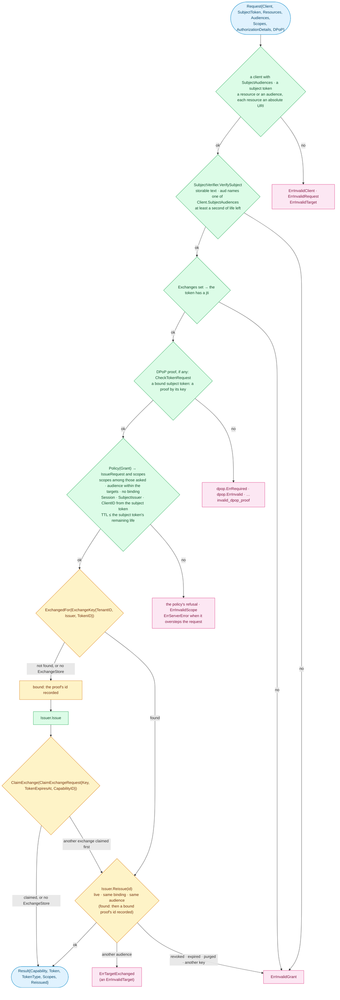

The proof's id is recorded only once everything else has passed and before
any capability exists, so a replayed proof never mints one. `ErrorOf` maps
each refusal to the RFC 6749 §5.2 error the endpoint answers;
[errors.md](errors.md#the-exchanges-codes) lists them. A capability presented
as the subject token (`IssuedTokenTypeCapability`) goes to `Exchanger.Narrow`
instead, which verifies it, asks a `NarrowPolicy` and delegates
(`Issuer.Delegate`).
