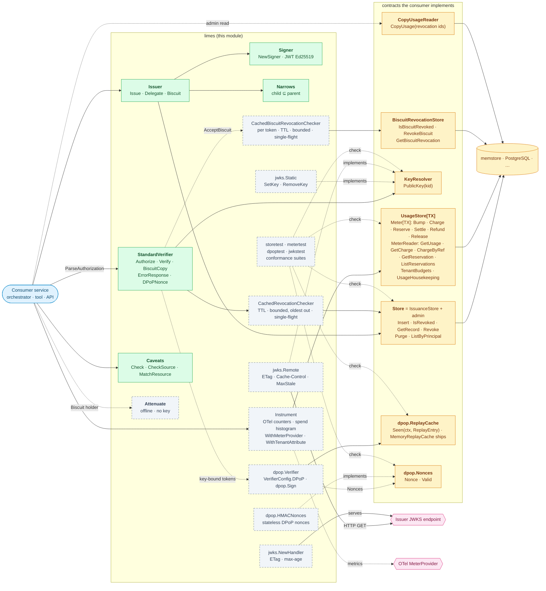
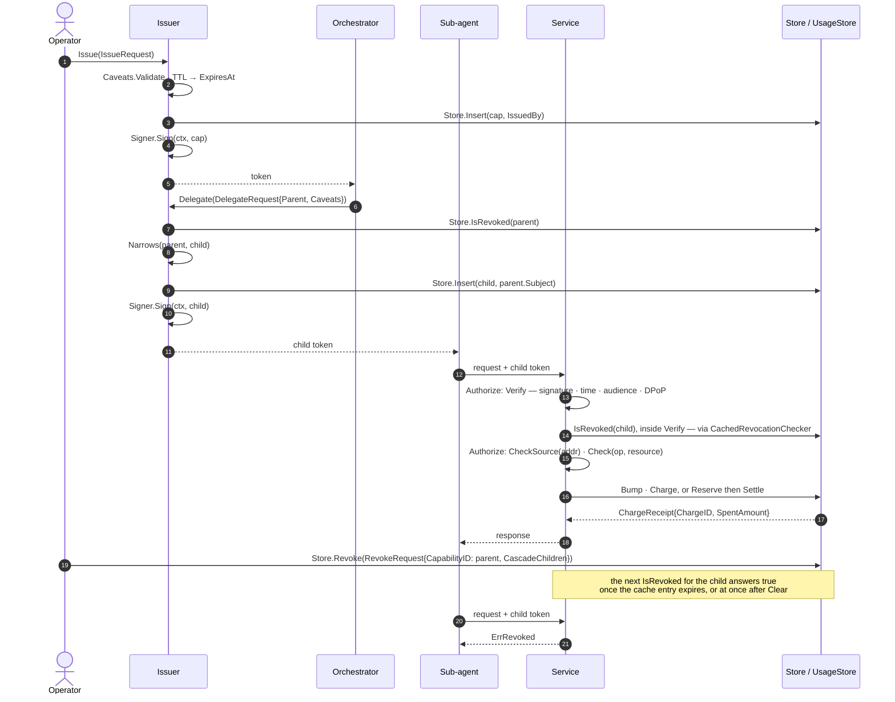
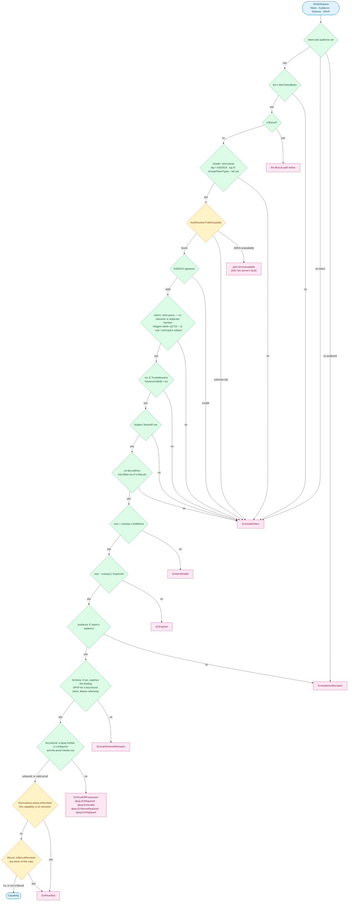
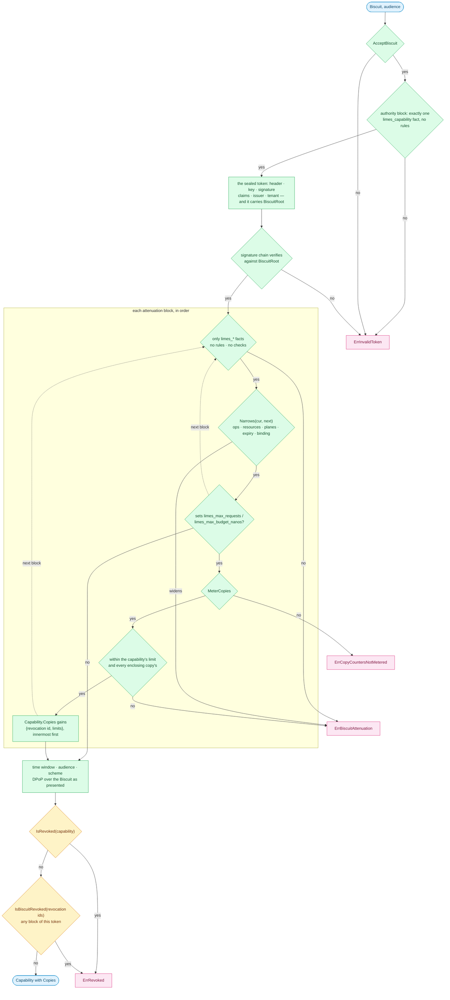
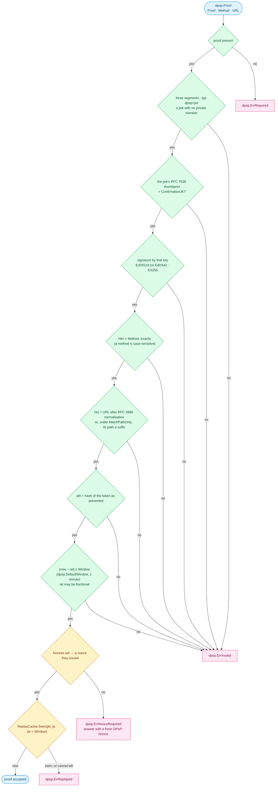
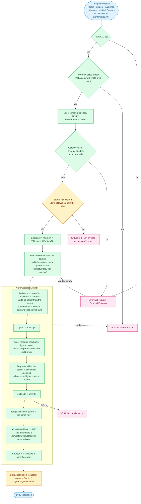
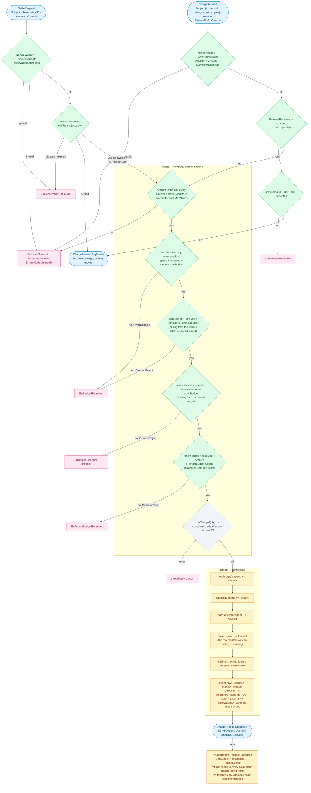
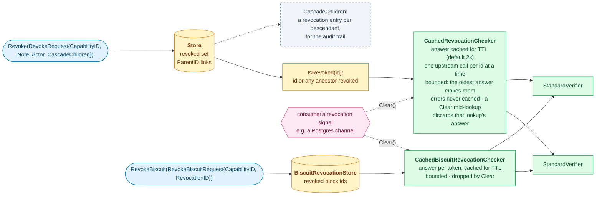

# Diagrams

Drawn from the code of this module. The prose that explains the behaviour is in
[README.md](../README.md) and the package documentation in
[doc.go](../doc.go); the identifiers on the diagrams are the exported names, so
a renamed type shows up as a stale label.

Colours follow the rest of the repository: blue for callers, green for what
this module ships, amber for the contracts a consumer implements and stores
behind them, grey dashed for optional pieces, pink for things outside the
process.

## Contract boundary

The module ships the primitive and its contracts; the consumer supplies the
storage behind them. `memstore` is the in-memory reference implementation; a
store over a database is the consumer's own. The two Biscuit contracts are
needed only by a consumer that accepts the Biscuit form, and `dpop.ReplayCache` and
`dpop.Nonces` only by one that binds capabilities to keys. `storetest`, `metertest`,
`dpoptest` and `jwkstest` check an implementation against its contract from its own tests.

Every read names what it reads — `Store.GetRecord`, `MeterReader.GetUsage`,
`TenantBudgets.GetTenantBudget` — so one type may implement `Store` and
`UsageStore` together, or each apart as `memstore` does. `TX` is the
consumer's transaction handle; the module only threads it back through
`Meter.Charge` and `Meter.Settle`, which is why it has no database dependency.

## Lifecycle of a capability

One orchestrator, one sub-agent, one service. Every call carries a token; the
service verifies it locally, enforces the caveats, then meters the call.

## Verification gates

`StandardVerifier.Verify` reads nothing from the claims until the signature
over them has verified, checks a key-bound capability's proof of possession,
and asks the revocation store last so that cheap rejections never reach it.
Every refusal is a sentinel the caller maps to its own transport status, or
hands to `ErrorResponse`; the one exception is a revocation lookup that fails,
which returns the store's error wrapped.

An unknown kid, an untrusted issuer, a kid bound to another issuer and a
missing tenant all match `ErrInvalidToken`; an unknown kid also matches
`jwks.ErrUnknownKID`, and the rest carry nothing more to branch on. An unreachable
JWKS is the server's fault, not the token's: it is `jwks.ErrUnavailable` alone,
which `ErrorResponse` answers with 503. The DPoP refusals and
`ErrAuthSchemeMismatch` match `ErrProofOfPossession` — the token may be
genuine, the proof is what failed — and every refusal of the credentials,
token or proof, matches `ErrUnauthenticated`, as does `ErrNoCredentials`
from `ParseAuthorization`.

A Biscuit goes through the same gates, around them. Its authority block seals
an ordinary signed token, which passes the gates from the header to the tenant;
that token names the key rooting the Biscuit's chain, which is checked next,
and then each attenuation block is folded in. The time window, the audience,
the scheme and the proof of possession — over the Biscuit as presented — apply
once, to the narrowed capability that comes out, and both revocation lists are
asked last.

The sealed token presented on its own is refused, so it cannot be lifted out
to shed an attenuation. `ErrBiscuitAttenuation` and
`ErrCopyCountersNotMetered` both match `ErrInvalidToken`: the token is not
one this verifier accepts.

## Proof of possession

A key-bound capability (`ConfirmationJKT` set) needs a DPoP proof (RFC 9449)
for every request; a verifier with no `dpop.Verifier` refuses it outright with
`dpop.ErrRequired`. The `dpop` package checks the proof in this order and
returns its own sentinel; the verifier wraps each refusal in
`ErrProofOfPossession`, and passes a replay cache or nonce store that cannot
answer through as an outage:

`dpop.HMACNonces` makes a nonce of its issuance time and an HMAC of it, so replicas
holding the same keys accept each other's nonces with no shared state, given
clocks within `dpop.HMACNonceClockSkew`. `dpop.MemoryReplayCache` gives each key a share
of its own, so one key past its share has only its own proofs refused; a full
cache refuses rather than forgets.

## Answering a refusal

`StandardVerifier.ErrorResponse` maps a refusal to how a protected resource
answers it, from the same table `ReasonOf` reads, and `WriteErrorResponse`
writes it as `application/problem+json` with `Cache-Control: no-store`. The
error's own text never reaches the client.

| Refusal | Status | `WWW-Authenticate` |
|---|---|---|
| `jwks.ErrUnavailable` | 503 | none |
| `ErrNoCredentials` | 401 | a bare challenge, no error code (RFC 6750 §3.1): no header, or another scheme's |
| `ErrMalformedAuthorization` | 400 | `error="invalid_request"` under the client's scheme (Bearer when unknown) |
| `dpop.ErrNonceRequired` | 401 | `DPoP error="use_dpop_nonce"`, and a fresh `DPoP-Nonce` |
| `dpop.ErrRequired` · `dpop.ErrInvalid` · `dpop.ErrReplayed`, and any other `ErrProofOfPossession` | 401 | `DPoP error="invalid_dpop_proof", algs="Ed25519 ES256"` |
| `ErrAuthSchemeMismatch` · `ErrInvalidToken` · `ErrExpired` · `ErrNotYetValid` · `ErrRevoked` · `ErrAudienceMismatch`, and any other `ErrUnauthenticated` | 401 | `error="invalid_token"` under the client's scheme (Bearer when unknown) |
| any `ErrCaveatViolation` | 403 | `error="insufficient_scope"` |
| `ErrBudgetExceeded` · `ErrTenantBudgetExceeded` · `ErrRequestLimitExceeded` | 403 | none |
| anything else — a store or key resolver outage, `ErrEffectConflict` | 500 | none |

A verifier with DPoP configured adds a bare `DPoP algs="…"` challenge beside a
`Bearer` one.

## What the bearer may do

Verification proves the token is genuine. What the bearer may do with it is a
second step, evaluated per operation: `Authorize` runs `Verify`, then
`Caveats.CheckSource(ClientAddr)`, then `Caveats.Check`:

A built-in operation keeps its own effect; a consumer's operation is a write
unless its `Effect` says otherwise. `ErrEffectConflict` is a programming error,
not a caveat violation; each of the other four matches `ErrCaveatViolation`.
The source-address caveat
is per connection and checked by `Caveats.CheckSource`, which fails closed on
an unknown address with `ErrSourceIPNotAllowed`. Budget and request ceilings
are stateful and belong to the `UsageStore`.

## Delegation: attenuate, never escalate

`Issuer.Delegate` refuses a parent read from a Biscuit copy, fills what the request leaves out from the parent — tenant, audience,
key binding, and the caveats under `InheritCaveats` — refuses a parent that is
expired or revoked, clamps the child's window inside the parent's, and then
requires `Narrows(parent, child)` to pass before anything is persisted or
signed.

Narrowing bounds each child on its own. The tree as a whole is bounded at use:
every charge also counts against each ancestor, read from the ancestor's
stored record. A parent holding 25.00 that delegates 20.00 to each of two
workers can still spend 25.00 in total, not 40.00:

## Biscuit copies: one tree, revoked and counted by block

Every attenuation appends a block, and every block has a revocation id — its
signature. A copy carries the ids of every block above it, so an id names a
copy *and everything attenuated from it*. The same ids key both of the things
a holder's copy can have on its own: a revocation, and limits.

- **Revocation.** `BiscuitCopy` checks that a copy is genuine — its size, the
  sealed token's signature, issuer and tenant, and its chain and blocks — but
  not its expiry, audience, proof or revocation, since a copy can be revoked
  whatever its state; it names the capability and the last block's id, which
  `BiscuitRevocationStore.RevokeBiscuit` lists. Revoking the capability still
  stops every copy and the JWT.
- **Limits.** A block may set `limes_max_requests` and `limes_max_budget_nanos`, within
  every limit in force. The `Meter` counts each under the block's id, beside
  the capability's own counters, and a charge or reservation records the ids
  it debited so a refund, settle or release returns to them.
  `CopyUsageReader` reads the counters back.
- **Delegation from a copy** narrows from the copy as presented, not from the
  capability's record. A copy with limits of its own cannot delegate:
  `Issuer.Delegate` refuses a `Parent` with `Copies` (`ErrDelegationTooWide`),
  because a server-side child counts against the capability and never the
  copy, and would shed its limits.

## Charge: stage, then commit

Every amount on this path is `Nanos`, an `int64` count of billionths of the
unit, so each comparison and sum below is exact.

`Meter.Charge` checks every ceiling — each Biscuit copy's, the capability's,
each ancestor's and the tenant's — and runs the consumer's side effect before
any counter moves. A rejection at any stage, or a failing `onCharged`, leaves
the capability's counter, every ancestor's, the tenant aggregate and the
ledger exactly as they were, so a retry after a rejection is safe.

A cost known only afterwards goes through a reservation instead. `Reserve`
holds an estimate against the same ceilings, and `Settle` charges the
actual cost along the same path, releasing the hold in the same commit. Every
ceiling counts open holds as well as spend, so two callers cannot both hold
the last of a budget.

`Bump` takes the same order for requests: each copy's limit, then the
capability's, then each ancestor's. A reservation keeps its copies' budgets,
so `Settle` checks them without being handed the token again.

A settle rejected by a ceiling leaves the reservation in place, to be settled
lower or released with `Release`. Under `OverrunRecord` no ceiling rejects: a
check that fails marks the charge as an overrun and the stage goes on, since
the cost has already been incurred; the crossed ceiling then refuses whatever
follows under `OverrunReject`. A mismatched unit or a counter past `MaxNanos`
is refused even then: neither is a ceiling an overrun may cross. A charge
named by `ExternalRef`, or a settle of a reservation already settled, returns
the earlier charge and moves nothing; the same `ExternalRef` with another
amount, unit or tenant is `ErrExternalRefConflict`.

Holds and housekeeping, in `memstore` as the contract has them:

- `Reserve` checks the same ceilings — never overrun — and holds the amount on
  the capability, each ancestor, the tenant (creating its row) and each copy;
  `Release` and `ReleaseExpired` take it off again. A hold never settled lapses
  at its `ExpiresAt` (default `DefaultReservationTTL`, five minutes) but keeps
  counting until `ReleaseExpired` runs, which errs towards refusing spend.
- `Delete` releases the capability's holds before it drops its counters, and
  `PurgeOrphans` releases the holds of every capability no longer on record:
  nothing could settle or release them afterwards.
- `SetTenantBudget` is guarded by `ExpectedVersion` (0 for a tenant with no
  ceiling yet), refuses a new unit while anything is held in the old one, or
  spent in it unless `ResetSpend` closes that spend, and with `ResetSpend` opens a new accounting period, so a refund of an
  earlier period's charge leaves the new period's spend alone.

A store with transactions runs stage and commit inside one, and passes its own
handle as `tx`; a store without them is instantiated as
`UsageStore[struct{}]` and the caller passes `nil` for `onCharged`.

## Revocation reaches the verifiers

Revocation is a write to the `Store`; verifiers see it through
`IsRevoked`, which answers for the whole delegation chain, usually behind a
`CachedRevocationChecker`.

Revoking a capability stops everything delegated from it whether or not
`CascadeChildren` is set, because `IsRevoked` walks the ancestors; the flag
only adds the per-descendant entries that name each stopped capability. Without
a revocation signal, a verifier learns of a revocation within the cache TTL.
Each cache is dropped whole: an answer cached for a descendant is also an
answer about the revoked ancestor. A `Clear` also detaches any lookup in flight, whose answer may
predate the revocation, so it is neither cached nor shared with later checks.
Revoked Biscuit copies travel the same way, on their own list and cache; one
signal clears both.

A verifier that runs apart from the issuer resolves keys with
`jwks.Remote`. It asks for `application/jwk-set+json`, keeps a set as
long as the response's `Cache-Control` says — `max-age` less `Age`, zero for
`no-cache` or `no-store` — within `MinRefreshInterval` and `RefreshInterval`
(`RefreshInterval` when the response says nothing), revalidates with an ETag,
refetches on an unknown kid at most once per `MinRefreshInterval`, and fails
closed with `jwks.ErrUnavailable` when it has never fetched a set, or once the
last good set is older than `MaxStale`. A document with entries but no usable
Ed25519 key counts as a failed fetch, so the last good set stays in service;
two entries under one kid are both dropped. The issuer serves the set with `jwks.NewHandler`: a strong ETag
answering `If-None-Match` with 304, and `Cache-Control: public, max-age`.
