# Diagrams

Drawn from the code of this module. The prose that explains the behaviour is in
[README.md](../README.md) and the package documentation in
[doc.go](../doc.go); the identifiers on the diagrams are the exported names, so
a renamed type shows up as a stale label.

Colours follow the rest of the repository: blue for callers, green for what
this module ships, amber for the contracts a consumer implements and stores
behind them, grey dashed for optional pieces, pink for things outside the
process.

## Contract boundary

The module ships the primitive and its contracts; the consumer supplies the
storage behind them, or takes one of the stores this repository ships:
`memstore` in memory, and the nested modules `pgstore`, every store contract
over PostgreSQL with row-level security, `redisreplay`, a
`dpop.ReplayCache` over Redis, and `otelmetric`, OpenTelemetry instruments
around a `meter.UsageStore`. Each nested module has its own `go.mod` and its own tag
line, so the root module's dependency graph stays free of a driver and of
OpenTelemetry.
The two Biscuit contracts are needed only by a consumer that accepts the
Biscuit form, `dpop.ReplayCache` and `dpop.Nonces` only by one that binds
capabilities to keys, `meter.LedgerReader` only by one that bills or reports from the
charges ledger, `RecordCensus` only by one that reports on records, and the two tenant erasers only by one that removes a tenant. `storetest`, `metertest`, `dpop/dpoptest` and
`jwks/jwkstest` check an implementation against its contract from its own
tests — the Biscuit and copy contracts too, when the store under test
implements them — and bound every check by `Env.CheckTimeout`, so a store that
deadlocks fails the check instead of hanging the run.

```mermaid
flowchart LR
    caller(["Consumer service<br/>orchestrator · tool · API"])

    subgraph mod ["limes (this module)"]
        direction TB
        issuer["<b>Issuer</b><br/>Issue · Delegate · Biscuit"]
        signer["<b>Signer</b><br/>NewSigner · JWT Ed25519"]
        narrows["<b>Narrows</b><br/>child ⊆ parent"]
        verifier["<b>Verifier</b><br/>Authorize · Verify · BiscuitCopy<br/>ErrorResponse · DPoPNonce"]
        caveats["<b>Caveats</b><br/>Check · CheckSource · AllowsResource"]
        cache["RevocationCache<br/>TTL · bounded, oldest out · single-flight"]
        bcache["BiscuitRevocationCache<br/>per revocation id · TTL · bounded · single-flight"]
        attenuate["<b>Attenuate</b><br/>offline · no key"]
        static["jwks.Static<br/>SetKey · RemoveKey"]
        remote["jwks.Remote<br/>ETag · Cache-Control · MaxStale<br/>held keys served, refreshed behind"]
        dpop["dpop.Verifier<br/>VerifierConfig.DPoP · dpop.Sign"]
        suites["storetest · metertest<br/>dpoptest · jwkstest<br/>conformance suites · CheckTimeout"]
        jwksh["jwks.NewHandler<br/>ETag · max-age"]
        nonce["dpop.HMACNonces<br/>stateless DPoP nonces"]
    end

    subgraph contracts ["contracts the consumer implements"]
        direction TB
        store["<b>Store</b> = IssuanceStore + admin<br/>Insert · IsRevoked · GetRecord · Revoke<br/>Purge · ListByPrincipal"]
        usage["<b>meter.UsageStore</b><br/>Meter: Bump · Charge · Reserve · Settle · Refund · Release<br/>MeterReader: GetUsage · GetCharge · ChargeByRef · GetReservation · ListReservations<br/>TenantBudgets · UsageHousekeeping"]
        keys["<b>KeyResolver</b><br/>PublicKey(kid)"]
        brev["<b>BiscuitRevocationStore</b><br/>IsBiscuitRevoked · RevokeBiscuit<br/>GetBiscuitRevocation"]
        cusage["<b>meter.CopyUsageReader</b><br/>CopyUsage(CopyUsageRequest{CapabilityID, RevocationIDs})<br/>→ CopyUsageResult{Copies}"]
        replay["<b>dpop.ReplayCache</b><br/>Seen(ctx, ReplayEntry) · MemoryReplayCache ships"]
        nonces["<b>dpop.Nonces</b><br/>Nonce · Valid"]
        ledger["<b>meter.LedgerReader</b><br/>SumCharges(SumChargesRequest) → Page[ChargeSum]<br/>one tenant or every tenant · by unit · bucket none/hour/day/week/month<br/>GroupBy tenant · op · actor · capability · Filter"]
        census["<b>RecordCensus</b><br/>CountRecords(CountRecordsRequest) → Page[RecordCount]<br/>one tenant or all · by tenant · principal type<br/>active · expired · revoked · delegated · expiring soon"]
        erasers["<b>TenantRecordEraser · meter.TenantUsageEraser</b><br/>EraseTenantRecords · EraseTenantUsage"]
    end

    impl[("memstore · your own store")]
    pg["<b>pgstore</b> (nested module)<br/>Store · BiscuitRevocationStore · erasers<br/>UsageStore · CopyUsageReader · Ledger · Census<br/>Migrate · CheckSchema · EraseTenant<br/>WithTenant · WithAllTenants · WithAllTenantsReadOnly<br/>RevocationWatcher · row-level security"]
    rr["<b>redisreplay</b> (nested module)<br/>Cache: dpop.ReplayCache over Redis"]
    metering["<b>otelmetric</b> (nested module)<br/>Instrument: OTel counters · spend histogram<br/>WithMeterProvider · WithTenantAttribute"]
    pgdb{{"PostgreSQL"}}
    redis{{"Redis"}}
    jwks{{"Issuer JWKS endpoint"}}
    otel{{"OTel MeterProvider"}}

    caller --> issuer
    caller -- "ParseAuthorization" --> verifier
    caller --> caveats
    caller --> metering
    caller -. "Biscuit holder" .-> attenuate
    issuer --> narrows
    issuer --> signer
    issuer --> store
    verifier --> keys
    verifier --> cache --> store
    verifier -. "VerifierConfig.Biscuit" .-> bcache --> brev
    caller -. "admin read" .-> cusage
    caller -. "billing read" .-> ledger
    caller -. "records report" .-> census
    caller -. "remove a tenant" .-> erasers
    metering --> usage
    metering -. "metrics" .-> otel
    static -. "implements" .-> keys
    remote -. "implements" .-> keys
    remote -- "HTTP GET" --> jwks
    verifier -. "key-bound tokens" .-> dpop --> replay
    dpop -. "Nonces" .-> nonces
    nonce -. "implements" .-> nonces
    jwksh -- "serves" --> jwks
    suites -. "check" .-> store
    suites -. "check" .-> usage
    suites -. "check" .-> keys
    suites -. "check" .-> replay
    suites -. "check" .-> nonces
    suites -. "check" .-> brev
    suites -. "check" .-> cusage
    suites -. "check" .-> ledger
    suites -. "check" .-> census
    suites -. "check" .-> erasers
    store --> impl
    usage --> impl
    brev --> impl
    cusage --> impl
    ledger --> impl
    census --> impl
    erasers --> impl
    pg -. "implements" .-> store
    pg -. "implements" .-> usage
    pg -. "implements" .-> brev
    pg -. "implements" .-> cusage
    pg -. "implements" .-> ledger
    pg -. "implements" .-> census
    pg -. "implements" .-> erasers
    pg --> pgdb
    rr -. "implements" .-> replay
    rr --> redis

    classDef client fill:#E0F2FE,stroke:#0284C7,color:#0C4A6E
    classDef role fill:#DCFCE7,stroke:#16A34A,color:#14532D
    classDef optional fill:#F1F5F9,stroke:#64748B,color:#334155,stroke-dasharray:5 4
    classDef store fill:#FEF3C7,stroke:#D97706,color:#78350F
    classDef external fill:#FCE7F3,stroke:#DB2777,color:#831843
    class caller client
    class issuer,signer,narrows,verifier,caveats role
    class cache,metering,static,remote,bcache,attenuate,dpop,suites,jwksh,nonce,pg,rr optional
    class store,usage,keys,impl,brev,cusage,replay,nonces,ledger,census,erasers store
    class jwks,otel,pgdb,redis external
```

The roles take narrower contracts than the stores implement: `IssuerConfig.Store`
is an `IssuanceStore` (Insert · IsRevoked), `VerifierConfig.Revocations` a
`RevocationLookup` and `BiscuitConfig.Revocations` a
`BiscuitRevocationLookup`. A `Meter` counts against a `MeterSubject`, which
only `VerifiedCapability.MeterSubject` or `StoredMeterSubject` over a
`RecordReader` builds, so a charge always names a capability the verifier or
the store vouched for.

Every read names what it reads — `Store.GetRecord`, `MeterReader.GetUsage`,
`TenantBudgets.GetTenantBudget` — so one type may implement `Store` and
`UsageStore` together, or each apart as `memstore` does. A store puts its
transaction in the context `Meter.Charge` and `Meter.Settle` hand
`onCharged`, read through its own accessor (`pgstore.TxFrom`); the module
never names a transaction type, which is why it has no database dependency.

## Lifecycle of a capability

One orchestrator, one sub-agent, one service. Every call carries a token; the
service verifies it locally, enforces the caveats, then meters the call.

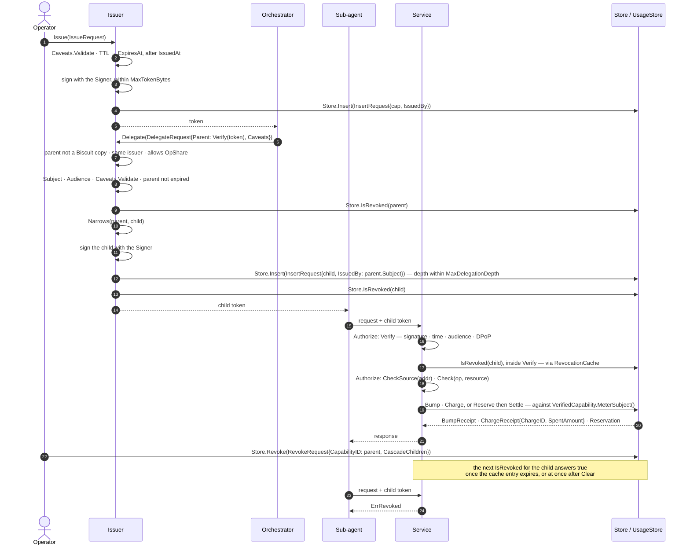

## Verification gates

`Verifier.Verify` reads nothing from the claims until the signature
over them has verified, checks a key-bound capability's proof of possession,
and asks the revocation store after every check that needs no I/O, so that
cheap rejections never reach it. A token carrying a Biscuit copy's own limits
is then refused at a verifier without `MeterCopies`, and only a token accepted
after all of that has its proof's id recorded in the replay cache: that room is
shared by every copy of the capability, so a revoked or refused token spends
none of it.
Every refusal is a sentinel the caller maps to its own transport status, or
hands to `ErrorResponse`. An outage is not a refusal: a key resolver other
than for an unknown kid, a revocation lookup, a replay cache or a nonce
source that cannot answer returns its error wrapped, and a key-bound
capability at a verifier with no `dpop.Verifier` is `ErrProofUnsupported` —
the deployment's fault, answered 500.

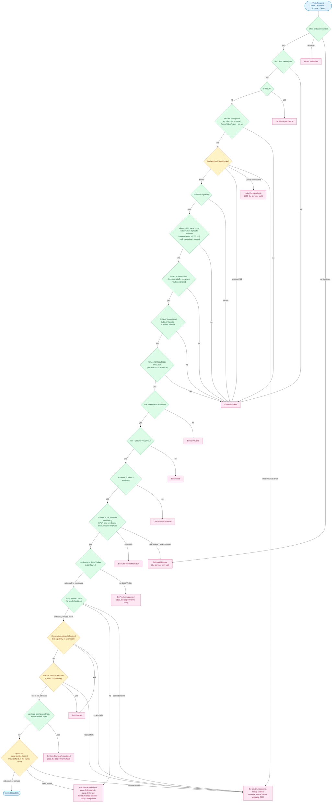

An unknown kid, an untrusted issuer, a kid bound to another issuer and a
missing tenant all match `ErrInvalidToken`; an unknown kid also matches
`jwks.ErrUnknownKID`, and the rest carry nothing more to branch on. An unreachable
JWKS is the server's fault, not the token's: it is `jwks.ErrUnavailable` alone,
which `ErrorResponse` answers with 503 — with `jwks.Remote`, so is a kid the
held set lacks while the endpoint is failing, and a caller that gave up
waiting with no set to serve. The DPoP refusals and
`ErrAuthSchemeMismatch` match `ErrProofOfPossession` — the token may be
genuine, the proof is what failed — and every refusal of the credentials,
token or proof, matches `ErrUnauthenticated`, as does `ErrNoCredentials`
from `ParseAuthorization`.

A Biscuit goes through the same gates, around them. Its authority block seals
an ordinary signed token, which passes the gates from the header to the tenant;
that token names the key rooting the Biscuit's chain, which is checked next,
and then each attenuation block is folded in. The time window, the audience,
the scheme and the proof of possession — over the Biscuit as presented — apply
once, to the narrowed capability that comes out; both revocation lists are
asked after them, and only then is a copy with counters refused at a verifier
that does not meter them; the proof's id is recorded last, as for any token.

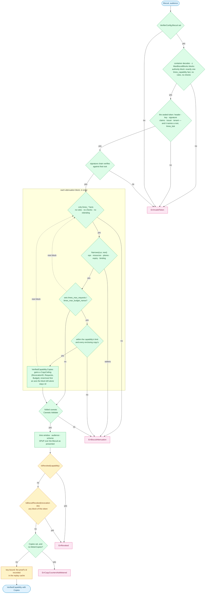

The sealed token presented on its own is refused, so it cannot be lifted out
to shed an attenuation. `ErrBiscuitAttenuation` matches `ErrInvalidToken`:
the token is not one this verifier accepts. `ErrCopyCountersNotMetered` does
not: the same token passes a verifier with `MeterCopies`, so the refusal is
the server's configuration, answered as an internal error.

## Proof of possession

A key-bound capability (`ConfirmationJKT` set) needs a DPoP proof (RFC 9449)
for every request; a verifier with no `dpop.Verifier` cannot check one and
answers `ErrProofUnsupported`. The `dpop` package checks the proof in this order and
returns its own sentinel; the verifier wraps each refusal in
`ErrProofOfPossession`, and passes a replay cache or nonce store that cannot
answer through as an outage:

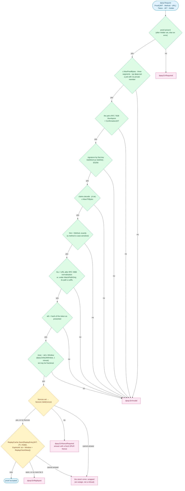

`dpop.HMACNonces` makes a nonce of its issuance time and an HMAC of it, so replicas
holding the same keys accept each other's nonces with no shared state, given
clocks within `dpop.HMACNonceClockSkew`. `dpop.MemoryReplayCache` gives each holder — the
capability the token carries — a share of its own, so one past its share has
only its own proofs refused, however many keys its Biscuit copies are bound
to; a full cache refuses rather than forgets. `redisreplay.Cache` keeps the
same per-holder share in Redis, so replicas share one cache; it has no bound
on the whole. A proof past
`MaxProofBytes` is refused unread, and a `jti` past `dpop.MaxJTIBytes` is
refused as `dpop.ErrInvalid`, never stored.

## Answering a refusal

`Verifier.ErrorResponse` maps a refusal to how a protected resource
answers it, from the same table `ReasonOf` reads, and `WriteErrorResponse`
writes it as `application/problem+json` with `Cache-Control: no-store`. The
error's own text never reaches the client.

| Refusal | Status | `WWW-Authenticate` |
|---|---|---|
| `jwks.ErrUnavailable` | 503 | none |
| `ErrNoCredentials` | 401 | a challenge with no error code, only the realm (RFC 6750 §3.1): no header, or another scheme's |
| `ErrMalformedAuthorization` | 400 | `error="invalid_request"` under the client's scheme (Bearer when unknown) |
| `dpop.ErrNonceRequired` | 401 | `DPoP error="use_dpop_nonce"`, and a fresh `DPoP-Nonce` |
| `dpop.ErrRequired` · `dpop.ErrInvalid` · `dpop.ErrReplayed`, and any other `ErrProofOfPossession` | 401 | `DPoP error="invalid_dpop_proof", algs="Ed25519 ES256"` |
| `ErrAuthSchemeMismatch` · `ErrInvalidToken` · `ErrExpired` · `ErrNotYetValid` · `ErrRevoked` · `ErrAudienceMismatch`, and any other `ErrUnauthenticated` | 401 | `error="invalid_token"` under the client's scheme (Bearer when unknown) |
| any `ErrCaveatViolation` | 403 | `error="insufficient_scope"` |
| `ErrBudgetExceeded` · `ErrTenantBudgetExceeded` · `ErrRequestLimitExceeded` | 403 | none |
| anything else — a store or key resolver outage, `ErrProofUnsupported`, `ErrEffectConflict`, `ErrCopyCountersNotMetered` | 500 | none |

A verifier with DPoP configured adds a `DPoP algs="…"` challenge with no
error code beside a `Bearer` one, and every `DPoP` challenge it answers
carries `algs`. A challenge with an error code also carries
`error_description`, the refusal's fixed title — never the error's own. Every
challenge ends with `realm="…"`: `VerifierConfig.Realm`, or `DefaultRealm`.

## What the bearer may do

Verification proves the token is genuine. What the bearer may do with it is a
second step, evaluated per operation: `Authorize` runs `Verify`, then
`Caveats.CheckSource(ClientAddr)`, then `Caveats.Check`:

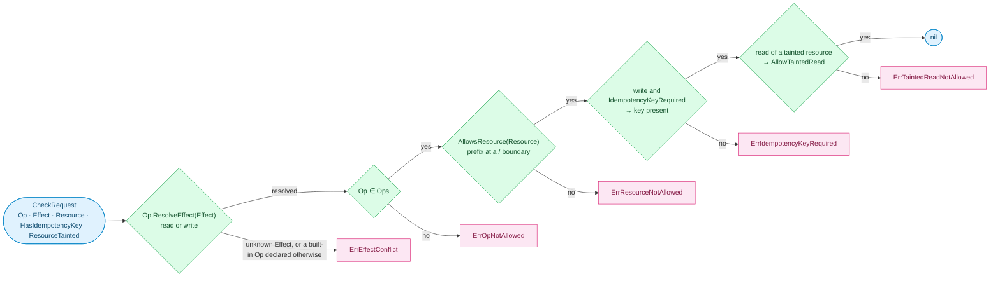

A built-in operation keeps its own effect; a consumer's operation is a write
unless its `Effect` says otherwise. `ErrEffectConflict` is a programming error,
not a caveat violation; each of the other four matches `ErrCaveatViolation`.
The source-address caveat
is per connection and checked by `Caveats.CheckSource`, which fails closed on
an unknown address with `ErrSourceIPNotAllowed`. Budget and request ceilings
are stateful and belong to the `UsageStore`.

## Delegation: attenuate, never escalate

`Issuer.Delegate` refuses a parent read from a Biscuit copy, one another
issuer minted, and one whose ops lack `OpShare` (`ErrOpNotAllowed`). It fills
what the request leaves out from the parent — tenant, audience, key binding,
and the caveats under `InheritCaveats` — refuses a parent that is expired or
revoked, clamps the child's window inside the parent's, and requires
`Narrows(parent, child)` to pass before anything is signed or persisted. A
Biscuit's holder attenuates the copy instead: a server-side child would be an
ordinary token of the capability, which revoking the copy would not reach and
the copy's limits would not bound.

```mermaid
flowchart TB
    req(["DelegateRequest<br/>Parent · Subject · Audience · Caveats or InheritCaveats<br/>TTL · NotBefore · ConfirmationJKT"])
    pid{"Parent.ID set"}
    copyp{"Parent not read from a Biscuit<br/>(FromBiscuit false, no Copies)"}
    own{"Parent.Issuer = this issuer"}
    share{"OpShare ∈ parent's Ops"}
    fill["unset tenant and audience taken from the parent<br/>InheritCaveats: the parent's caveats"]
    valid{"Subject.Validate · audience valid<br/>Caveats.Validate · thumbprint valid"}
    alive{"parent not expired<br/>Store.IsRevoked(parent) = false"}
    clamp["ExpiresAt = min(now + TTL, parent.ExpiresAt)<br/>unset binding taken from the parent"]
    start["starts no earlier than the parent:<br/>NotBefore raised to the parent's start<br/>(its NotBefore, else IssuedAt)"]

    subgraph nar ["Narrows(parent, child)"]
        direction TB
        n0["Audience ⊆ parent's · ExpiresAt ≤ parent's<br/>starts no earlier than the parent<br/>same tenant · a bound parent's child stays bound"]
        n1["Ops ⊆ parent.Ops"]
        n2["every resource reachable by the parent<br/>exact-URI parent admits no child prefix"]
        n3["Requests within the parent's: any under Unlimited,<br/>a bound no higher under a bound"]
        n4["Budget.UnitCode = parent's<br/>(none taken as the parent's)"]
        n5["Budget within the parent's, the same way"]
        n6["AllowTaintedRead only if the parent has it<br/>IdempotencyKeyRequired never relaxed"]
        n7["SourceIPCIDR inside a parent network"]
        n0 --> n1 --> n2 --> n3 --> n4 --> n5 --> n6 --> n7
    end

    sign["Issuer.sign: Signer.sign(ctx, child)<br/>token within MaxTokenBytes"]
    persist{"Store.Insert(InsertRequest{child,<br/>IssuedBy: parent.Subject})<br/>no more than MaxDelegationDepth ancestors"}
    depth{"Store.IsRevoked(child) returns no error<br/>(a backstop for a store that does not refuse;<br/>the child is already on record)"}
    ok(["IssueResult{Capability, Token}"])

    wide["ErrDelegationTooWide"]
    unit["ErrUnitCodeMismatch"]
    noshare["ErrOpNotAllowed"]
    dead["ErrExpired · ErrRevoked<br/>or the store's error"]
    inval["ErrInvalidRequest · ErrInvalidCaveats"]
    stored["the store's error<br/>ErrDelegationTooDeep, …"]

    req --> pid -- yes --> copyp -- yes --> own -- yes --> share -- yes --> fill --> valid -- yes --> alive -- yes --> clamp --> start --> n0
    n7 --> sign --> persist -- ok --> depth -- "no error" --> ok
    pid -- no --> inval
    copyp -- no --> inval
    own -- no --> inval
    share -- no --> noshare
    valid -- no --> inval
    clamp -- "negative TTL" --> inval
    start -- "window empty" --> inval
    alive -- no --> dead
    n4 -- differs --> unit
    nar -- widens --> wide
    sign -- "too long" --> inval
    persist -- refused --> stored
    depth -- "error, e.g. too deep" --> stored

    classDef client fill:#E0F2FE,stroke:#0284C7,color:#0C4A6E
    classDef role fill:#DCFCE7,stroke:#16A34A,color:#14532D
    classDef store fill:#FEF3C7,stroke:#D97706,color:#78350F
    classDef external fill:#FCE7F3,stroke:#DB2777,color:#831843
    class req,ok client
    class pid,fill,valid,copyp,own,share,clamp,start,sign,n0,n1,n2,n3,n4,n5,n6,n7 role
    class alive,persist,depth store
    class wide,unit,noshare,dead,inval,stored external
```

Narrowing bounds each child on its own. The tree as a whole is bounded at use:
every charge also counts against each ancestor, read from the ancestor's
stored record. A parent holding 25.00 that delegates 20.00 to each of two
workers can still spend 25.00 in total, not 40.00:

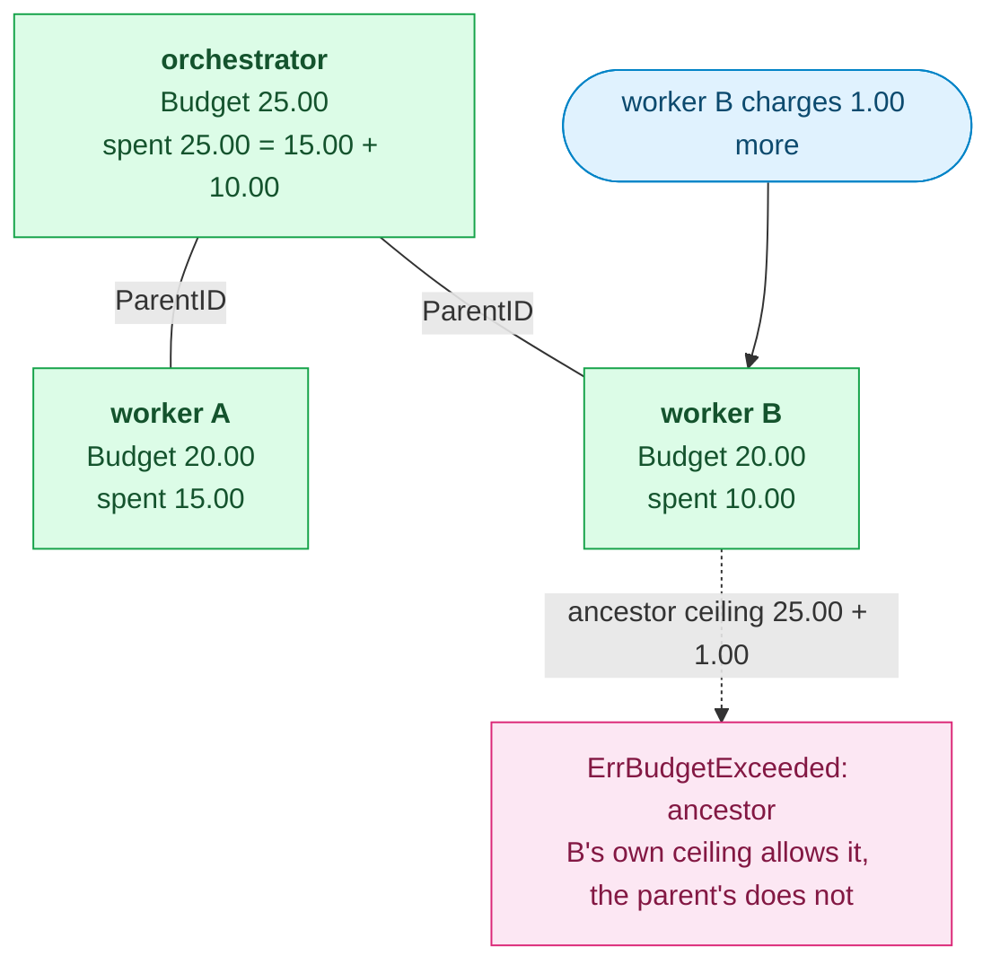

## Biscuit copies: one tree, revoked and counted by block

Every attenuation appends a block, and every block has a revocation id — its
signature. A copy carries the ids of every block above it, so an id names a
copy *and everything attenuated from it*. The same ids key both of the things
a holder's copy can have on its own: a revocation, and limits.

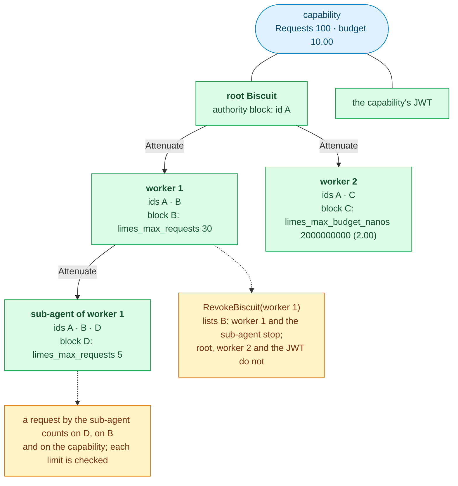

- **Revocation.** `BiscuitCopy` checks that a copy is genuine — its size, the
  sealed token's signature, issuer and tenant, and its chain and blocks — but
  not its expiry, audience, proof or revocation, since a copy can be revoked
  whatever its state; it names the capability and the last block's id, which
  `BiscuitRevocationStore.RevokeBiscuit` lists. Revoking the capability still
  stops every copy and the JWT.
- **Limits.** A block may set `limes_max_requests` and `limes_max_budget_nanos`, within
  every limit in force. The `Meter` counts each under the block's id, beside
  the capability's own counters, and a charge or reservation records the ids
  it debited so a refund, settle or release returns to them.
  `CopyUsageReader` reads the counters back.
- **No delegation from a copy.** `Issuer.Delegate` refuses any `Parent` read
  from a Biscuit (`VerifiedCapability.FromBiscuit`, with limits or without)
  as `ErrInvalidRequest`; see the delegation section above.

## Charge: stage, then commit

Every amount on this path is `Nanos`, an `int64` count of billionths of the
unit, so each comparison and sum below is exact.

`Meter.Charge` checks every ceiling — each Biscuit copy's, the capability's,
each ancestor's and the tenant's — and runs the consumer's side effect before
any counter moves. A rejection at any stage, or a failing `onCharged`, leaves
the capability's counter, every ancestor's, the tenant aggregate and the
ledger exactly as they were, so a retry after a rejection is safe.

A cost known only afterwards goes through a reservation instead. `Reserve`
holds an estimate against the same ceilings, and `Settle` charges the
actual cost along the same path, releasing the hold and deleting the
reservation in the same commit. Every ceiling counts open holds as well as
spend, so two callers cannot both hold the last of a budget. A settle takes
its hold off before it measures, so one at or below the hold fits every
ceiling that holds it — even one lowered or crossed since — and only an
amount past the hold, or an ancestor that does not hold it, is checked.

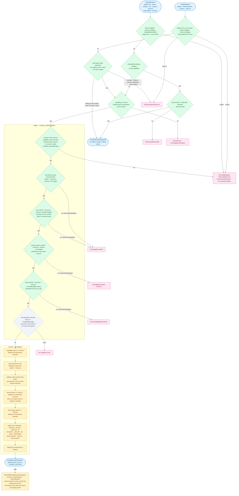

`Bump` takes the same order for requests: each copy's limit, then the
capability's, then each ancestor's. A reservation keeps its copies' budgets,
so `Settle` checks them without being handed them again; the subject settling
must still carry the same copies.

A settle rejected by a ceiling leaves the reservation in place, to be settled
lower or released with `Release`. Under `OverrunPolicyRecord` no ceiling rejects: a
check that fails marks the charge as an overrun and the stage goes on, since
the cost has already been incurred; the crossed ceiling then refuses whatever
follows under `OverrunPolicyReject`. A mismatched unit or a counter past `MaxNanos`
is refused even then: neither is a ceiling an overrun may cross. A charge
named by `ExternalRef`, or a settle of a reservation already settled, returns
the earlier charge and moves nothing; the same `ExternalRef` with another
amount, unit, tenant or Biscuit copy is `ErrExternalRefConflict`: another copy
charges its own counters, which the earlier receipt never touched.

Holds and housekeeping, in `memstore` and `pgstore` as the contract has them:

- `Reserve` checks the same ceilings — never overrun — and holds the amount on
  the capability, each ancestor, the tenant (creating its row) and each copy;
  `Release` and `ReleaseExpired` take it off again. A hold never settled lapses
  at its `ExpiresAt` — `DefaultReservationTTL`, five minutes, by default, and
  never later than its capability's expiry — but keeps counting until
  `ReleaseExpired` runs, which errs towards refusing spend. A revoked
  capability's hold stays settleable until then.
- `DeleteUsage` releases the capability's holds before it drops its counters
  and its copies', and `PurgeOrphans` releases the holds of every capability
  no longer on record, a batch of `Limit` at a time: nothing could settle or
  release them afterwards. Either takes the dropped ids off the ancestor
  lists of the holds that remain.
- `SetTenantBudget` is guarded by `ExpectedVersion` (0 for a tenant with no
  ceiling yet), refuses a new unit while anything is held in the old one, or
  spent in it unless `ResetSpend` closes that spend, and with `ResetSpend` opens a new accounting period, so a refund of an
  earlier period's charge leaves the new period's spend alone.

A store with transactions runs stage and commit inside one, and hands
`onCharged` a context carrying it, beside the receipt the call will return
(`Charged`); `onCharged` may be `nil`. A store without them hands on the
caller's context; `memstore` still runs `onCharged` before it publishes.

`pgstore` runs each call in one transaction, `onCharged` on that same
`pgx.Tx`, so a rejection or a failing side effect rolls everything back.
`Bump`, `Charge`, `Reserve`, `Settle` and `Release` first refuse a scope that does not
admit the subject's tenant, as `ErrScopeMismatch`, before any row is read. It
locks in one order, so two calls never wait on each other in a cycle: the
reservation being settled or released, then the lineage's records `FOR SHARE`
in id order — a purge locks its batch in the same order — then the tenant's
row, the usage rows by capability id and the copies' rows by revocation id. An
`ExternalRef` is looked up again once the locks are held, since a concurrent
delivery may have committed in between. A call holds one connection, so a
small pool serves as many calls at once as it has connections.

## Revocation reaches the verifiers

Revocation is a write to the `Store`; verifiers see it through
`IsRevoked`, which answers for the whole delegation chain, usually behind a
`RevocationCache`.

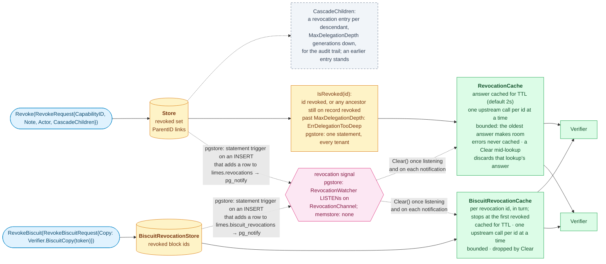

Revoking a capability stops everything delegated from it whether or not
`CascadeChildren` is set, because `IsRevoked` walks the ancestors; the flag
only adds the per-descendant entries that name each stopped capability. Without
a revocation signal, a verifier learns of a revocation within the cache TTL;
`pgstore`'s schema notifies a channel on every revocation, and its
`RevocationWatcher` clears the caches on each notification and after each
reconnect.
Each cache is dropped whole: an answer cached for a descendant is also an
answer about the revoked ancestor. A `Clear` also detaches any lookup in flight, whose answer may
predate the revocation, so it is neither cached nor shared with later checks.
Revoked Biscuit copies travel the same way, on their own list and cache; one
signal clears both.

In `pgstore`, `Revoke` and `RevokeBiscuit` run under the caller's tenant —
a capability it cannot see is `ErrNotFound` — while `IsRevoked` and
`IsBiscuitRevoked` are each one statement calling a `SECURITY DEFINER`
function of the schema, which sees every tenant: the verifier asks before it
knows the token's. A revocation entry is deleted with its record, so once
`Purge` reaps an ancestor the walk no longer reaches it — by then it has
expired, and so has every descendant.

A verifier that runs apart from the issuer resolves keys with
`jwks.Remote`. It asks for `application/jwk-set+json` (then `application/json`), keeps a set as
long as the response's `Cache-Control` says — `max-age` less `Age`, zero for
`no-cache` or `no-store` — within `MinRefreshInterval` and `RefreshInterval`
(`RefreshInterval` when the response says nothing), revalidates with an ETag,
refetches on an unknown kid at most once per `MinRefreshInterval`, and fails
closed with `jwks.ErrUnavailable` when it has never fetched a set, or once the
last good set is older than `MaxStale`. A known kid from a set past its
freshness but within `MaxStale` is served at once, its refresh started behind
the caller; an unknown kid while the endpoint is failing, or a caller that
gives up waiting with no set to serve, is `jwks.ErrUnavailable` too. Keys are
handed out as copies. A document with entries but no usable
Ed25519 key counts as a failed fetch, so the last good set stays in service;
two entries under one kid are both dropped. The issuer serves the set with `jwks.NewHandler`: a strong ETag
answering `If-None-Match` with 304, and `Cache-Control: public, max-age`.

## pgstore: a call under its tenant's scope

Every call of `pgstore` runs in a transaction that `Config.Scope` scopes first;
the default reads the scope a context carries. A call whose request names a
tenant is refused with `ErrScopeMismatch` when that scope does not admit the
tenant, before it reads a row, rather than answer as rows that are not there.
A call that writes is refused so under a read-only scope: before the
transaction under `WithAllTenantsReadOnly`, and once a `Config.Scope` of the
consumer's has run when it set `limes.all_tenants` to `read`. Row-level security then binds every statement: `tenant_visible` for reads,
`tenant_writable` for writes. The table owner, as `Migrate` runs, is not bound.

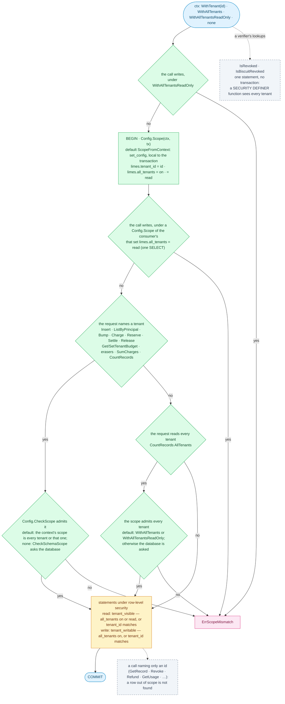

A consumer's own `Config.Scope` gets no check unless it also sets
`Config.CheckScope`; `CheckSchemaScope` serves one that sets the schema's own
settings.

## Erasing a tenant

`Store.EraseTenant` removes a tenant from `pgstore` in one transaction scoped
to it, and runs the consumer's `onErased` last in the same transaction, so the
consumer's rows of the tenant go with the store's or not at all. It locks in
the order the meter does, so it never waits on a meter call in a cycle.

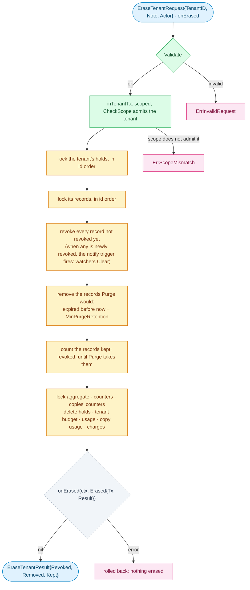

A record kept stays revoked: an id not on record is not revoked, so removing
a live record early would let its token through. The separate
`EraseTenantRecords` and `UsageStore.EraseTenantUsage` do each half alone, and
`memstore` implements both.
